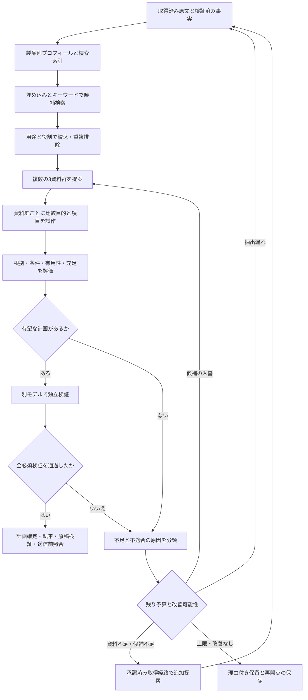

# 資料群と比較観点を共同で探索する設計

作成日：2026-10-10（日本時間）  
対象：newsWeave  
状態：shadow経路、意味による資料群提案・用途／役割プロフィール・巡回内の群除外・任意の根拠一覧工程と型検証済み候補を使う修復を実装。18資料・共同探索の累計92回。今回、3製品評価と6項目検証で一度合格したが、検証説明と実際の比較案の不整合を発見。修正版4項目の3製品評価は合格、独立検証の重要情報欠落で保留。暫定一覧を独立検証入力から除く修正と旧版合格の再利用禁止を追加し、現行方針で利用できる採用群は0件。新版のAPI再評価・記事成立・設計全体の実装は未完了。最新状態は[継続実装・評価](comparison-joint-discovery-evaluation-20261011.md)、初回評価は[実装・評価記録](comparison-joint-discovery-implementation-20261010.md)を参照  
提案する方針版：`comparison-discovery-v2`

## 1. 決定事項と目的

関連する資料を広く取得済みカタログから探し、3資料の組み合わせごとに比較目的と比較項目を仮説として生成する。資料群・観点・根拠を一体で評価し、読者の判断に役立つ組み合わせが得られた後、執筆前に比較計画を確定する。

「3資料」は、異なる3製品・サービスに対応する主たる発表資料3件を基本とする。同一製品の3発表や同一発表の転載3件を、3製品の比較として数えない。公式仕様・料金等の補助資料は追加可能だが、主たる発表資料の記載率を水増ししない。

決定事項は次のとおり。

- 類似検索は候補発見に使う。距離・類似度だけで比較適性や事実の正しさを判定しない。
- 埋め込み、キーワード、根拠付き用途・役割・機能の構造化を併用する。
- 比較項目は資料群ごとに生成する。料金や危険度評価を全テーマの固定必須項目にしない。
- 試作計画は複数生成・比較できる。確定後の項目・目的の変更は新しい計画版として再検証する。
- 根拠の正確さ、同じ問いへの回答、読者への有用性、主要項目の全製品充足、発表資料側の過半数条件は維持する。
- 品質不合格を別のモデルや旧方式へ迂回して送信しない。
- 実装・導入対象はnewsWeaveのみ。newsCollectionのコード・DB・設定・サービスを共用・変更しない。

本書は[元の改善計画](comparison-source-selection-improvement-plan.md)の探索・計画生成・選択手順を更新する設計である。旧計画の「元資料から質問を先に固定」「固定項目を満たす候補だけを選択」は本書の試作・共同探索へ置き換える。旧計画の権利・収集・履歴・根拠・重複・送信に関する保護条件は引き継ぐ。過去の計画・評価結果は書き換えない。

## 2. 現状と今回の評価からの設計課題

現行コードは `ComparisonPlanV1` を先に生成し、各候補がその質問へ回答できるか評価する。`choose_group()` は採用可能と判定済みの候補から資料群を選ぶ。このため、別の観点なら比較できる候補を、元計画の不足項目によって候補集合から早期に落とす。

[16資料追加評価](comparison-sixteen-source-evaluation-20261010.md)は、固定された対象・検査・報告・課金・危険度の質問についての結果である。別の観点で記事が成立するかの評価ではなく、「追加16資料では比較記事全般が作れない」という結論には使わない。

また、引用一致・数値・事実IDの検証だけでは、次を検出しきれなかった。

- OWASPへの検査準拠を危険度評価基準へ転用する。
- 背景に書かれた利用者の要望を提供済み機能へ変換する。
- 独立した段落にある「準備中」を、機能の引用へ引き継がない。
- 表・長い段落の抽出漏れを、原文の未記載と混同する。
- 編集側の候補採用理由そのものを、提供元が一次資料に書くべき事実と誤解する。

新設計では、検索改善と同時に、事実と条件の紐付け、原文への立ち戻り、編集判断の評価を改善する。

## 3. 全体の流れ



索引や比較評価は、それだけではItemを執筆・送信状態へ変更しない。確定監査を既存の記事処理へ明示的に引き継いだ時点で、通常の原稿・送信ゲートに接続する。

## 4. 検索と製品プロフィール

### 4.1 索引の単位

同一資料について、次の検索用表現を作る。

| 表現 | 内容 | 目的 |
| --- | --- | --- |
| 製品プロフィール | 主製品、解決する課題、役割、利用者、環境、主要な手法・出力 | 比較可能な用途を探す |
| 本文の段落・表 | 会社概要・連絡先を分離した技術・提供条件の範囲 | 要約で落ちる詳細を探す |
| キーワード索引 | 製品名、技術語、規格、機能語、同義語 | 埋め込みが取りこぼす固有語を探す |

製品プロフィールの事実欄には、確認済み事実IDと原文範囲を保持する。比較上の役割分類や同義語による検索表現は編集判断として別欄へ置き、新しい製品事実にしない。判断根拠が不足する項目はunknownにする。

各段落・表には `item_id`、版、原文範囲、製品対応、本文・抽出・証拠のhashを付ける。表の見出し・列と値、注記・適用範囲を保持し、行だけを切り離して別プランへ結び付けない。紹介・要望・実装済み機能・予定・導入事例・会社全体の事業を区別する。

埋め込みには索引用に必要な範囲だけを送る。連絡先・個人情報・注入が疑われる文・権利上利用できない資料は既存の検査を通す。索引用プロフィールを、本文の代わりに事実の根拠として引用しない。

### 4.2 埋め込みとキーワードの併用

埋め込みは同じモデル・次元・前処理版の集合内でコサイン距離を計算する。モデルが異なるベクトルは混ぜない。長文は意味の区切りで分け、入力制限を超えた部分を黙って捨てない。ゼロ長・非有限数・次元不一致は無効として記録する。

候補は埋め込み上位とキーワード上位の和集合を取り、順位による統合を行う。初期案は `sum(1 / (60 + rank))` であり、距離とキーワード点をそのまま足さない。段落ヒット数が多い長文だけが有利にならないよう、資料・製品単位に集約する。プロフィールと段落の寄与は別に記録する。

日本語のキーワード索引は空白区切りだけに依存せず、形態素・文字n-gram等の候補を評価データで比較して決める。検索の正規化・同義語辞書・分割方法も版管理する。語彙の一致は検索材料に留め、比較適性の判定へ直接置き換えない。

距離の固定閾値だけで候補を捨てず、上位数と用途判定を組み合わせる。近い資料が多すぎる場合は、重複を抑えつつ関連性を保つ再順位付けを行う。多様性は、同じ課題を満たす候補の中で確保する。IoTやAIなど広い分野だけが同じ候補を、違いが大きいという理由で採用しない。

索引未完成・埋め込み利用不可の場合は、キーワード＋構造化プロフィールの明示モードで探索できる。検索方法と索引の完成範囲を監査に残す。独立検証の利用不可や品質不合格を、この検索モード変更で救済しない。

### 4.3 元ニュースがある場合と資料群から探す場合

- `seeded`：元ニュースの製品を必ず含める。固定するのは根拠付きの製品とテーマの範囲・ユーザー指定条件であり、比較質問の一覧ではない。明示された記事目的は探索中も制約として維持する。
- `catalog`：元ニュース指定がない場合、用途・役割でカタログをまとめ、各集合から3製品群と記事テーマを提案する。主資料の中から記事の起点を選び、既存のItem単位処理に接続する。

初期実装はseededを優先する。catalogは同じ評価器を使う後続段階とし、同一資料の並行採用・記事テーマの重複をバッチ単位で管理する。

## 5. 資料群の生成と共同評価

### 5.1 比較項目を持たない粗い絞り込み

権利・重複・使用済み条件・現在版・品質を確認した後、用途、製品の役割、利用者の課題、提供時点を確認する。具体項目の充足によるeligible判定は、まだ行わない。

役割・課題の対応は根拠付きプロフィールで評価する。自己運用と外部委託など、同じ課題への異なる方法は候補にできる。通常の代替候補比較では、別工程の補完製品を除く。資料が似ていても同じ製品・発表なら一つへまとめる。

原文が古い場合は、歴史比較の明示がない限り現在の機能・価格として断定しない。鮮度を順位へ反映するとともに、現在条件の確認が不可欠な主張には追加資料を求める。古い資料の欠点を類似度の高さで相殺しない。

### 5.2 3資料群の提案

構造化された用途・役割が対応する製品のペアを作り、各ペアの適合性・不確実性・相違点を記録する。明らかな不適合ペアを含む3製品群は除く。不明なペアは有望性と予算に応じて追加確認する。

10製品を候補とした場合、catalogは最大120通り、元製品を含むseededは最大36通りである。全組み合わせへ詳細AIを呼ばず、既存プロフィールと抽出事実の共通性・差・鮮度で粗く順位付けする。共通性だけで同じ内容の資料が上位にならないよう、判断に役立つ相違点も見る。

初回は上位3組を詳細評価する。似た製品群ばかりの場合は、同じ課題の範囲で別方式の候補を含む組も残す。順位と採用・除外理由は再現可能に保存する。

### 5.3 組み合わせごとの比較仮説

各資料群から最大2つの仮説を作る。仮説は次の情報を持つ。

- 想定読者と、その読者が判断する一つの具体的な課題。
- なぜ各製品を同じ記事で比較できるかという編集判断と、その根拠。
- 主要項目3～5件と、必要な場合のみ補助項目0～2件。
- 各項目の共通質問、回答形式、重要性、適用条件、必要な根拠。
- 製品別の回答案、事実ID、原文・条件・発表時点、未確認情報。
- 重要な差や、項目に含めなかった情報を省くことの影響。

主要項目の「内容」を固定しない。項目数を満たすために弱い項目を増やさず、判断に役立つ主要項目を3件も作れない組み合わせは、初期設計では保留する。将来この件数要件を見直す場合も、全テーマで別途評価して方針版を変える。

例：診断の内製化を扱う仮説なら、必要な入力、操作自動化、実行環境、結果確認、開発工程への接続から選ぶ。診断委託なら、対象範囲、人による確認、報告・再診断、作業条件等を検討する。料金比較を目的とする仮説なら、課金単位・税・含まれる作業等を必須にする。これらは生成例であり、今回の資料で各項目が揃うと主張するものではない。

### 5.4 合格にしやすい項目だけを選ばないための条件

試作時点で項目を変更できるが、次の制約を持たせる。

- 「関連分野」「AI使用」等の広い共通点だけでは主要項目にしない。
- 全セルが「対応」で終わる項目は、対応方式・範囲・条件の差が判断に必要な場合だけ採用する。
- 比較目的に重要な情報を、未記載だからという理由だけで省かない。省略が読者の判断を歪める場合は仮説を不合格にする。
- 「最安」「安全性が高い」などの結論が必要とする情報を欠く仮説は、その結論を生成できない。
- 項目追加・削除・目的変更を、理由・残る不確実性・親仮説との関係とともに保存する。同じ目的の欠点を解消しない名前変更は、新たな有効試行と数えない。
- ユーザーが指定した目的を、成立しやすい別目的へ自動変更しない。自由探索の範囲で別の仮説を作る場合は目的の変更を明示する。

### 5.5 比較目的の前に作る暫定根拠一覧（任意のshadow工程）

`--evidence-first` を指定した場合、選ばれた3資料から最大6つの開かれた質問と、各資料の回答・事実ID・条件を先に生成する。質問は固定チェックリストではなく、その資料群の開示された違いから作る。全質問に各資料の欄を1つずつ設け、非開示の欄はunknown・参照なしとする。質問のrequiredはfalseとし、主要項目をこの段階で固定しない。

各回答は既存の所有資料・引用アンカー・数値・条件検査を使う。`fact_constraints` にある税・単位・通貨コード・帰属等の文字列を、回答またはconditionsへ文字どおり残す。条件付きの事実をdocumentedへ変えない。1つの誤りだけでなく、複数の失敗欄を最大20件の安全な診断として修復へ渡す。

この一覧はモデルの暫定判断であり、検証済み事実や記事の承認ではない。数値と引用の検査を通っても、異なる問いの混在・意味の転用・不適切な比較目的は残り得る。共同計画が原文と再照合し、通常の個別評価と6項目独立検証を行う。計画が保留でも成功した一覧と実際のAiRun参照を監査へ残し、同じ入力で再開すると再利用する。

計画・根拠一覧の修復では、スキーマ・正規化を通った今回の比較候補だけをメモリー内に保持し、失敗欄とともに次の修復へ渡す。候補は原文より下位の未承認データとして扱い、入力長上限を守る。スキーマ不正の生応答や過去評価ファイル全体は修復へ渡さず、拒否本文や未知数値は診断・無効AiRunのoutput_jsonへ保存しない。この変更をプロフィールのfingerprintへ含める。

`editorial_intent` が未指定なら、資料が支えられる有用な比較目的を探索する。発表時点の記載から「何を調べ、何を確認するか」を判断する目的と、現在の購入先を決める目的を区別する。前者でも同一タスク・有用な差分・重要な不足の明示は必要。明示されたユーザー目的を勝手に狭めない。異なる課金単位を料金構造として比較できる場合も、単位換算・同等性・現在の提供可否を推測しない。

## 6. 固定する品質条件と順位付け

### 6.1 得点では相殺できない条件

| 条件 | 確認内容 |
| --- | --- |
| 製品・発表の独立性 | 異なる3製品・主たる発表3件。正規化URL、本文、転載、発表対応を照合 |
| 同じ判断課題 | 全製品の採用理由が、その仮説の読者・用途・役割に対応 |
| 質問の同一性 | 行の全セルが同じ質問と回答形式に対応。出力へ導入実績を混ぜない |
| 主要項目の充足 | 全3製品に有効な回答と根拠。unknown・incomparableを解消した扱いにしない |
| 表示項目の過半数 | 製品単位で過半数、主たる発表資料単位でも過半数に特徴の記載 |
| 値と条件 | 製品・プラン・版・地域・時点・税・単位・予定・オプションを維持 |
| 原文・意味の一致 | 事実ID・範囲・引用の一致に加え、その引用が質問へ回答するか確認 |
| 重要情報の欠落 | 記事目的に不可欠な条件・差を隠していない |
| 未使用・権利 | バッチ条件と全履歴照合、収集条件、原文品質を満たす |

3件の主発表で「過半数」は2件以上。補助資料に記載があっても主発表の記載票を増やさない。主発表を選び直した場合は別資料群として再評価する。

予定・条件付きの回答は、仮説の目的と記述次第で有効だが、現在利用可能な機能を比較する行で準備中の画面を「利用可」としない。非対応は原文が明示した場合だけ有効な回答とし、未記載を非対応・提供なしへ変換しない。主要項目にその情報が必要なら保留する。

### 6.2 合格候補間の順位

根拠付きの評価理由と、以下の0～1の編集評価を保存する。初期の重み案は読者への有用性0.35、選択を変える相違点0.25、説明の明確さ0.20、情報の鮮度・粒度0.20とする。重みは評価用の仮定であり、測定済みの最適値ではない。

まず品質条件を満たす計画だけを残し、その中を順位付けする。不合格の高得点計画を選ばない。項目数の多さ、URL数、AIへの合格回数は記事品質の加点対象にしない。

順位が接近する複数計画は、重複の少なさや読み比べる価値も確認する。最終選択と落とした仮説の理由を監査に残す。

## 7. 不足・抽出漏れ・条件の扱い

不足理由を分類し、それに応じた工程だけをやり直す。

| 理由 | 次の処理 |
| --- | --- |
| 原文にあるが未抽出 | 該当段落・表を指定して追加抽出し、通常の検証を通して証拠改訂を追加 |
| 原文に未記載 | 必須なら公式補助資料を探索。主発表側の過半数は別に判定 |
| 役割・用途の不一致 | 候補・資料群を入替。類似度を上げるだけの再検索はしない |
| 仮説が読者の判断に役立たない | 根拠付きの別仮説か別資料群を作成 |
| 予定・版・プランの条件不整合 | 同じ条件の資料を確認。解消できなければ限定記述か保留 |
| 資料間の矛盾 | 矛盾を保持し、現在条件の一次資料を確認。新しい日付だけで推測解消しない |
| AIの形式・事実参照・意味の不正 | 同じ仮説について修復1回。無効な出力を採用せず履歴を保存 |
| 一時障害・使用量上限 | 待機状態と再開点を保存。確定工程を繰返さない |

「原文に未記載」の判定前に、本文・表・注記の検索と対象箇所の追加抽出を確認する。抽出結果にないことと原文にないことを区別する。画像・PDF・表が未解析なら、その範囲を未解析として保存し、未記載へ置換しない。

条件は引用文字列の一部であるだけでなく、製品・機能・プラン・表の列・注記の対象へ明示的に結び付ける。機能段落とは別に「現在準備中」がある場合でも、対象機能の事実と比較セルへ継承する。複数機能の一部にだけ適用する注記を、全機能へ一律適用しない。対象が特定できなければ不確実性として残す。

全資料の短い引用だけで条件を評価できない場合、検証へ周辺段落・見出し・注記を渡す。本文全体を毎回送る必要はないが、引用した一文だけで判定を完結させない。

## 8. 独立検証と記事への接続

別モデルには、仮説の目的、資料群、比較表、各製品の採用理由、根拠、周辺文脈と条件対応、欠落検査の結果を渡す。計画・評価に使ったモデルと検証モデルの独立性を実際の実行記録から検査する。

独立検証の入力は、確定した仮説と3製品評価のgroup、3資料の原文文脈・検証済み事実、実際のeditorial_intentに限定する。暫定根拠一覧、粗い群提案、旧仮説、探索用ヒントは渡さない。資料にある情報と、比較案に実際に残した情報を混同しないよう、重要条件を保持した／欠落したという説明は実際のセル・条件・採用理由・不足情報の文面と照合する。

この入力境界の変更を `discovery_review-v2` とする。現行の凍結確認では独立検証AiRunのprompt_versionを現在の検証方針版と照合し、旧版の合格は `DISCOVERY_FROZEN_REVIEW_POLICY_CHANGED` で拒否する。旧監査や実行記録は消去・改ざんせず、現在の入力と方針で再検証する。計画・個別評価の完了工程は、その実質入力・スキーマ・プロフィールが同じなら再利用できる。

独立検証は次を評価する。

1. 同じ判断課題に対する比較として妥当か。
2. 行ごとの質問・回答形式が一致しているか。
3. 主要項目の全製品充足と、製品・発表資料それぞれの過半数を満たすか。
4. 根拠・値・条件・現在提供と予定・発表時点が整合しているか。
5. 採用理由と項目が、読者の判断に役立つ具体的な差を説明できるか。
6. 比較目的に重要な情報を省くことで、誤った印象を作っていないか。

採用理由は編集判断である。提供元の一次資料に「この記事の比較対象にした理由」という文章があることを要求しない。その判断を支える用途・役割・手法・条件等の事実と、説明が妥当かを検証する。比較対象として採用する理由と、購入推薦の根拠を区別する。

全必須検証に合格した仮説を `frozen` とし、目的・項目・資料版・根拠・方針・実行モデルを固定する。独立検証済みの内容と同じhashを記事パッケージへ渡す。凍結後の事実更新・条件変更・主資料の変更は検証を失効させ、新しい版で再検証する。

本文は短い導入、比較表、項目ごとの差と用途別の選択条件、出典、実際のAI実行に基づくモデル表記を基本とする。既存の事実検証・原稿検証を保持し、v2の比較意味・欠落検査と凍結計画との一致を追加する。検証件数と方針版は新しい版として管理し、旧記事を自動昇格しない。

送信直前に権利・資料版・証拠版・使用済み履歴・同時実行の競合を再確認する。凍結監査、独立検証、原稿検証、送信前照合が揃った新規原稿だけをWordPress下書きに送る。

## 9. データ契約と保存

以下は新規契約の設計名であり、現行V1をそのまま上書きするものではない。

| 契約 | 主な内容 |
| --- | --- |
| `ComparisonDiscoveryRequestV2` | seeded/catalog、元Item、ユーザー目的・制約、除外基準、探索予算、方針版 |
| `ProductComparisonProfileV2` | 製品対応、用途・役割・利用者・環境、特徴・差・不確実性、根拠と文脈のhash |
| `RetrievalCandidateSetV2` | 検索語、索引版、検索方式、各方式の順位、候補・除外理由、索引未完成範囲 |
| `ComparisonGroupProposalV2` | 3製品と主発表、補助資料、ペア適合性、粗い順位、元ニュースの包含 |
| `ComparisonHypothesisV2` | 目的・読者・採用理由、主要/補助質問、回答、欠落情報、親仮説、変更理由、draft/frozen |
| `FactContextBindingV2` | 対象製品・機能・プラン、条件・時点・提供状態、原文範囲、注記・表構造への参照 |
| `ComparisonGroupEvaluationV2` | 合格条件の判定、根拠付き編集評価、保留理由、独立検証とAI実行ID |
| `ComparisonDiscoveryAuditV2` | 候補集合、資料群・仮説・除外履歴、費用・試行数、選択計画hash、保留/完了・再開点 |

全契約にID、スキーマ版、方針版、入力hash、必要な親ID・時刻を持たせる。埋め込み距離・順位、事実、編集判断を別欄へ保存する。セルは根拠の製品・資料の所有元を検証し、別製品の価格・機能を引用できない。

比較監査・工程出力は当面、現行の `module_messages` に新しい契約型・consumerとして追記する。AIの構造化出力は `ai_runs` の実行記録へ接続する。埋め込みは既存の文章生成用 `AIRunner` へ無理に渡さず、専用portと実行メタデータを設ける。実行roleの値は現行DBの長さ制限も確認して追加する。

検索用に次のテーブルを追加する案とする。

- `comparison_profile_index`：製品・資料版・hash・プロフィール契約参照・有効状態。追記改訂と現在版を区別する。
- `comparison_embedding_index`：profile/chunk、原文範囲、入力hash、provider/model/revision、次元、前処理版、ベクトル、実行ID。
- `comparison_embedding_runs`：入力件数・トークン・費用・所要時間・状態・エラー。秘密情報やベクトル全体を通常ログへ出さない。
- `comparison_source_reservations`：batch/target、正規化資料・同一発表key、探索監査ID、予約状態・期限・publication対応。

費用は索引構築と記事探索を区別し、利用者が総費用を把握できるよう同じバッチにも集計する。索引作成の費用を記事側の実測から隠さない。

予約は仮説検討時点ではなく、採用資料群の独立検証後に取得する。送信前にローカルDBの一意制約・ロックとWordPressの再読取で競合を確認する。外部アプリでの同時使用はDB予約だけで防げないため、検出時は再選択または保留する。予約期限切れ・障害後も冪等キーと送信状態を確認し、重複送信しない。

有効予約の一意キーは `exclusion_scope_key + announcement_key` を基本とする。globalならWordPress送信先、batchならバッチIDをscopeにする。個別Itemをscopeにして別記事同士の競合を見逃さない。補助資料も同じ再利用禁止条件に含め、既存の送信履歴は予約の期限が切れても除外基準として維持する。

### 9.1 ベクトルの保存方式

初期方式は、PostgreSQLのJSON配列へ保存し、有効資料のベクトルを読み込んでPythonで正確な距離を計算する交換可能なbackendとする。索引対象数と処理時間を測り、全件読取が許容できない規模になったらpgvectorへ移行する。ベクトル比較のモデル・版・次元・数値検証はどちらも同じ仕様にする。

現行 `compose.yaml` はPostgreSQL 17系の通常イメージを指定し、pgvector導入設定は見当たらない。実行環境に拡張があると仮定せず、初期設計でDBイメージ交換を必須にしない。pgvector移行時は拡張の実利用可否、固定イメージ、バックアップ、既存ボリューム互換、SQLiteテストのbackend、検索結果の一致を検証する。

pgvectorを採用する場合も、最初は正確検索を基準とする。近似索引は測定後に検討し、近似検索の取りこぼし・フィルタ後の候補減少を評価する。独立検証や本文の根拠をベクトル検索の返却結果で代用しない。

## 10. 探索予算・キャッシュ・再開

次は初期設定案であり、現在の環境変数でも実測済み最適値でもない。ユーザーが指定した件数・予算がある場合はそちらを上限として優先する。

| 設定案 | 初期値 | 数え方 |
| --- | --- | --- |
| retrieval_pool_size | 30製品 | 検索方式の和集合を製品単位に集約した後 |
| detailed_product_limit | 10製品 | 元製品を含む。未キャッシュプロフィールの詳細確認上限 |
| initial_group_limit | 3組 | 初回に詳細化する資料群 |
| group_limit_total | 5組 | 全巡回累計。無効な評価で試行済みの群も数える |
| hypotheses_per_group | 2 | 同一群で生成する異なる目的・項目の仮説 |
| hypothesis_limit_total | 8 | 全巡回累計。初回を最大6仮説とし、後続の余地を残す |
| independent_review_limit_total | 2計画 | 同じ計画の形式修復は別API呼出として費用に計上 |
| additional_rounds | 2巡 | 初回に加えて最大2巡。改善可能性がない場合は早期終了 |
| new_documents_limit_total | 12資料 | 補助資料を含む全巡回累計。ユーザー指定の追加資料数を超えない |
| search_query_limit_total | 8回 | 外部検索のみ。登録資料検索と分けて計数 |
| semantic_api_call_limit_total | 30回 | プロフィール・曖昧ペア確認・仮説・独立検証・各修復を含む |

事実抽出・埋め込み・原稿作成にも別上限とバッチ全体の呼出・トークン・費用上限を設ける。上表の枠を使い切る保証はせず、上限に達した時点で理由付き保留にする。例えばプロフィール10回、曖昧ペア確認6回、仮説8回、独立検証と修復4回なら28回であり、実際の形式修復等が残り枠を超えれば打ち切る。1回のAPI応答に複数仮説を含む場合も論理仮説数と呼出数は別に数える。

段階ごとの予算は永続化し、再開でリセットしない。未知の料金体系では金額をゼロと扱わず、呼出数とトークンの上限で管理し、費用未推定を表示する。無効出力・一時エラー・再試行の実費も記録する。ローカル計算の上限、入力長制限、待機時間も設定対象とする。

キャッシュキーは、原文・証拠・製品対応・文脈、検索索引、プロフィール、候補集合、仮説、制約、方針、プロンプト、実行モデル、スキーマの該当hashを含める。失敗出力を成功として再利用しない。同じ入力の失敗を無限に再試行しない。

後続工程で新しい根拠が必要になった場合は、その工程と依存する計画・評価だけを再作成する。保存済み原文を再取得したり、埋め込み・プロフィールを無条件に再作成したりしない。API使用量上限は `waiting_quota` と再開点を保存し、利用可能になった時に未確定工程から続ける。再開日時や通知はアプリ側の既存予約依頼と二重登録しない。

同じ資料群・目的・項目・根拠で前巡から変化がない場合は `NO_NEW_COMPARISON_EVIDENCE`、予算到達は `DISCOVERY_BUDGET_EXHAUSTED`、適切な仮説がない場合は `NO_USEFUL_COMPARISON_PLAN` を保留理由として分ける。

## 11. 現行処理との接続と実装範囲

| 箇所 | 設計する変更 |
| --- | --- |
| `app/contracts/comparison_discovery_v2.py`（追加） | 探索・プロフィール・資料群・仮説・監査のV2契約 |
| `app/core/comparison_discovery.py`（追加） | 主資料票、製品対応、組合せ、項目と根拠の決定的検査、順位 |
| `app/orchestration/comparison_discovery.py`（追加） | retrieval→group→hypothesis→reviewの巡回、予算・再開・凍結 |
| `app/infrastructure/comparison_retrieval.py`（追加） | キーワード・正確ベクトル・将来pgvectorのbackend切替 |
| 埋め込みport・provider（追加） | 索引用のモデル・次元・前処理版・実行記録 |
| `app/modules/extraction/facts.py` と関連契約 | 表・注記・条件対象、追加抽出、原文未解析と未記載の区別 |
| `app/orchestration/research.py` | 固定質問による候補の早期排除を新経路で置換。追加取得の既存制限へ接続 |
| `app/orchestration/comparison_selection.py` | V1明示評価を保持。新経路はV2へ分離し、V1評価を合格へ書き換えない |
| `app/core/article_selection.py` と記事パッケージ契約 | 凍結V2監査の保存・現在版・所有元・実行モデルを再確認 |
| 原稿検証・publication | V2方針版と独立検証を必須化。旧方式への自動迂回を禁止 |
| `app/cli.py` | 明示的なdiscover shadowコマンド、元資料・目的・除外・予算・出力の引数 |
| DBモデル・Alembic（追加） | 索引・埋め込み実行・予約をnewsWeaveのDBに追加 |

V1の `CandidateSuitabilityV1.decision` は固定計画に対する判定である。V2の粗い検索適合を同じdecisionへ押し込まない。V1の独立検証が5項目である点や、記事パッケージがV1監査を前提とする点も、単なるJSON型変換では解消しない。新契約型・検証版・読取分岐を明示し、既存保存データの読取互換を維持する。

最終送信で参照する契約と監査を一つに定める。V1とV2の両方を同じ原稿へ混在させて、どちらかが合格なら送る構成にしない。

提案CLI例（未実装）：

```console
news-weave comparison discover --mode shadow --seed <元資料UUID> --output <監査JSON>
news-weave comparison discover --mode shadow --scope catalog --output <監査JSON>
```

shadow評価は原稿・WordPress送信を行わず、本番schedulerの設定を変更しない。自動経路のスイッチは実装段階で明示して追加し、現行のlegacy/shadow値を本書作成時点で変更しない。

## 12. 評価方法と受入条件

同じ原文・証拠・除外条件・費用上限の下で、現行固定項目方式、構造化プロフィール方式、埋め込み併用方式を比較する。類似検索の上位が良いことと、記事が良いことを別々に評価する。

評価データは既存3資料群と今回の16資料だけに限定しない。生成AI・IoT・セキュリティ等で、最低20ペア・6資料群を開発用に用意し、最終評価は別の資料群で行う。成立可能例、成立不能例、別観点なら成立する例、抽出漏れ、条件差、古い料金、補完関係を含める。

決定的な試験では、少なくとも次を確認する。

- 別観点なら成立する群を、不要な固定料金・評価基準によって候補から落とさない。
- 合格項目だけを並べた無意味な表や、判断に重要な欠落を隠す仮説を拒否する。
- 3主発表の2件以上、全製品の主要項目という別々の充足条件を検査する。
- 複数補助ページ・同一製品・転載で製品数や主発表票を増やせない。
- 別段落の準備中、Free/有料の条件、表の列、Web/プラットフォーム別料金を保持する。
- 採用理由の原文への逐語一致ではなく、編集判断を支える事実参照と意味を検証する。
- ベクトルのモデル・次元・版の混在、失効索引、部分索引、検索方式の縮退を扱える。
- 同じ上限を再開で使い直さず、キャッシュ・予約・送信を重複させない。
- 原稿・送信時の資料変更・同時使用で合格監査が失効する。
- V1の履歴・既存下書き・newsCollectionを変更しない。

人が確認する指標は、候補の適合率・取りこぼし、資料群の妥当性、行の同一質問性、判断に役立つ違い、重要な欠落、過剰保留、記事品質、総費用・所要時間とする。AIの合格数や作成記事数だけを成功指標にしない。

導入の初期受入目標は、明確な役割不一致例と根拠・所有元不正例の全拒否、人手評価で採用群の90%以上が適切、選択した全セルの根拠有効性、成立可能例の取りこぼしと保留理由の報告とする。90%は目標であり、現時点の達成値ではない。3件の新規試作記事を人が確認し、独立比較検証・原稿検証・WordPress下書き保存を確認するまで本番自動経路の完了としない。

## 13. 実装と導入の順序

| 段階 | 実施内容 | 完了条件 |
| --- | --- | --- |
| 1 | V2契約、仮説・変更理由・監査、品質条件、評価用資料群 | 固定項目と可変観点を区別し、人が計画と根拠を確認できる |
| 2 | 構造化プロフィール、キーワード検索、複数群・仮説、shadow CLI | ベクトルなしでも共同探索を実証。不要な固定項目による取りこぼしを減らす |
| 3 | 埋め込み索引、正確距離、順位統合、多様性、費用記録 | 候補発見の改善と費用を段階2との比較で測定 |
| 4 | 条件・注記・表の対応、追加抽出、独立検証、凍結計画 | 引用一致だけの誤採用、条件消失、重要情報の省略を検出 |
| 5 | 公式補助資料の取得・製品対応、不足別の巡回・再開 | 取得制限・主発表票・全巡回予算を維持して追加探索 |
| 6 | V2記事パッケージ、原稿検証、予約、送信前再確認 | 適切な3試作記事の下書きと既存履歴の保護を確認 |
| 7 | newsWeaveのみで設定導入、監視、必要に応じpgvector | 実測品質・費用・再開・重複送信防止を満たす |

埋め込み導入を先に必須とせず、共同探索の意味評価を段階2で検証する。段階3で検索の効果を切り分けることで、ベクトル検索が改善しても記事評価が悪化する場合を検出できる。

本書の作成では設計文書のみを追加・参照更新する。実装、DB移行、埋め込み呼出、追加取得、既存資料の再評価、scheduler切替、WordPress送信は実施しない。

## 14. 技術上の参照と設計判断の区別

- [Dense Passage Retrieval（EMNLP 2020）](https://aclanthology.org/2020.emnlp-main.550/)：埋め込みによる関連する文書範囲の検索の研究。本設計の比較記事生成・3製品群の品質を保証する研究結果としては扱わない。
- [CMUのMMR解説](https://www.cs.cmu.edu/afs/cs.cmu.edu/academic/class/15381-s01/public/www/lec/ir/jgc-ir-handout.pdf)：関連性と冗長性を考慮した順位付けの考え方。用途の異なる製品まで混ぜるためには使わない。
- [pgvector公式リポジトリ](https://github.com/pgvector/pgvector)：PostgreSQLでの正確・近似ベクトル検索と距離計算。利用には拡張導入・有効化を要する。現行環境で導入済みとは扱わない。

候補数、仮説数、予算、順位付けの重み、JSON backendの初期採用、契約・導入順序はnewsWeave向けの設計判断である。実測と受入評価で調整し、研究・外部製品の仕様から記事の成立率を推定しない。
