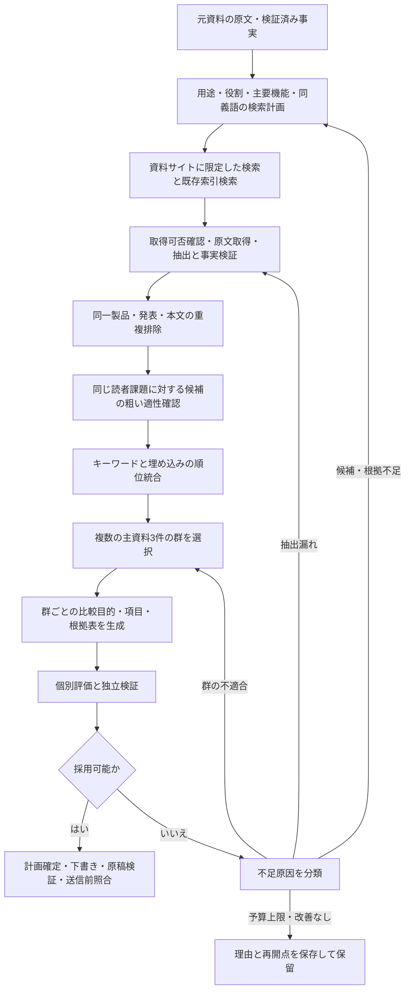

# 資料取得・選択を起点とする比較記事の改善計画

作成日：2026-10-11（日本時間）  
対象：newsWeaveのみ  
状態：今後の実装・評価計画。未実施の工程を実施済みとして扱わない。

更新：同日の追加依頼による資料選択の12ステップは、[PR TIMESカテゴリ検索・最短距離ペアによる修正計画](comparison-prtimes-pair-selection-plan-20261011.md)を優先する。本書は従来方針の記録として保持し、新経路の選択順序・検証条件・再試行・監査は新計画を参照する。

## 1. 改善の方針

比較に適した主資料3件と必要な根拠を集める工程を優先する。元資料の特徴から資料サイトを検索し、用途・役割・情報量を確認した候補集合を作る。その集合でキーワードと埋め込みを併用して複数の3資料群を選び、群ごとに比較目的と項目を生成・評価する。

資料群に適切な共通課題や根拠がない場合、同じ群の計画修復を繰り返しても解決しない。原因に応じて資料群の入替、補助資料の取得、原文の再抽出へ戻る。固定の料金・危険度等を全テーマの必須検索条件にはしない。

本書は[共同探索設計](comparison-joint-discovery-design.md)を具体的な実装順と受入評価へ落とす実行計画である。元設計の品質条件は維持し、外部探索を先送りして同じ3資料の後処理へ偏る順序を改める。過去の評価記録は保持する。

## 2. 開始時点の事実

| 項目 | 現状 | 今後の扱い |
| --- | --- | --- |
| 評価用資料 | PR TIMESの既存2件＋追加16件、計18資料・重複排除後15製品 | 固定した回帰用集合として保存。追加取得集合と分けて測る |
| 追加16件の取得 | 事前列挙URLから原文取得。検索語・検索順位を追跡できる取得経路ではない | 元資料から検索結果、取得原文までの履歴を新設 |
| 候補未指定の共同探索 | DBの発表日順による上限付き候補取得後、キーワード順位付け | 検索索引から関連候補を取得し、日付順上限だけで関連資料を落とさない |
| キーワード | 検証済み事実＋編集目的、日本語二文字・英語語句の一致 | 比較用の特徴表現を追加し、語彙一致と比較適性を区別 |
| `semantic`方式 | LLMによる用途・役割プロフィールと群提案 | 埋め込み検索と区別して監査・評価 |
| 埋め込み | コサイン類似度・順位統合の計算部品のみ | 生成・保存・索引・探索への接続と実データ評価が必要 |
| 最新の詳細評価 | CyberCrew・VexCloud・AeyeScanを指定して再評価 | 全カタログからの自動選択成功には数えない |
| 記事へ引き継げる採用群 | 現行方針で0件。独立検証の新版はAPI未評価 | 判定説明と最終案の対応も確認し、形式合格だけで採用しない |

共同探索の累計92回は計画・修復・個別評価・独立検証のAI呼び出し数であり、ベクトル検索の評価回数ではない。最終コードの回帰試験は855件合格・3件スキップだが、記事成立や検索品質を保証する結果ではない。詳細は[継続評価記録](comparison-joint-discovery-evaluation-20261011.md)を参照する。

## 3. 目標の流れ

この図は目標構成であり、現行実装を示すものではない。補助資料は根拠を補えるが、独立した3製品の主資料数や主発表の記載率を増やす票にはしない。

## 4. 実装順序と各段階の完了条件

| 段階 | 主な作業 | 完了条件 |
| --- | --- | --- |
| 0：評価基準の固定 | 現行18資料・コード版・既存判定を保存。候補適性の人手ラベル、検索と記事評価の指標を定義 | 保存済み資料のみでキーワード基準値を再現でき、未実施の測定項目を明示できる |
| 1：特徴に基づくサイト検索 | 検索計画の契約、検索アダプター、許可サイト制約、取得キューを接続 | 元資料の根拠から検索語、結果順位、取得URL、検証済み事実まで追跡できる |
| 2：候補品質と根拠の整備 | 用途・役割・読者課題による粗い適性確認、重複排除、本文・表・注記の条件保持 | 同分野だけの不適合候補を説明付きで落とせる。非開示と抽出漏れを区別できる |
| 3：埋め込み検索 | 生成・キャッシュ・索引を実装し、既存のコサイン・順位統合へ接続 | 実際の検索方式と索引版を記録し、同じ集合で方式別の上位候補を再現できる |
| 4：群探索と不足別の巡回 | 複数群の動的項目生成、失敗原因に応じた追加検索・群入替 | 不適合群の修復へ偏らず、改善理由・消費予算・保留理由が追跡できる |
| 5：比較評価 | 固定集合で検索方式を比較。追加取得の効果を別実験で測定。未調整資料でも確認 | 候補適性と記事成立を分けた結果表、失敗例、費用・時間を報告できる |
| 6：下書きへの接続 | 凍結した計画を執筆・原稿検証・送信前予約へ引き継ぐ | 根拠・版・未使用条件を維持した下書きを確認し、既存の品質ゲートを通せる |

段階1は、検索事業者の認証・利用可能性を確認してから実接続する。接続できない場合はアダプターの模擬試験とローカル経路を先に完了し、外部検索の実証を未完了として残す。段階2と検索基盤の準備は進められるが、模擬結果を実検索の成果には数えない。

独立検証の入力修正の確認は段階0〜2の間に行う。ただし同じ3資料の再検証だけを先に繰り返すことを、候補取得・選択の改善の代わりにしない。

## 5. 元資料から作る検索計画

### 5.1 特徴と検索語

元資料から、解決する課題、用途、製品の役割、利用者、対象環境、主要機能・手法・成果物、発表時点を抽出する。各特徴に事実IDと原文範囲を付ける。検索用同義語や役割分類は編集上の拡張として区別し、製品の新しい事実にはしない。

検索は次の3系統に分け、検索意図を記録する。

1. 候補発見：共通の用途・課題＋機能語・同義語。初めから比較表の項目を固定しない。
2. 提供条件の確認：有望候補の製品名＋公式仕様・提供状況・料金等。記事目的に必要な範囲に限る。
3. 不足の解消：生成した比較案で不足した根拠に対応する語。新候補探索か既存候補の補助取得かを区別する。

検索語の例として、Web診断が原文から確認できる場合には「Webアプリ 脆弱性診断 クラウド」「脆弱性診断 自動化 サービス」等を、資料サイトのホスト制約と組み合わせる。これは実施済み検索でも、CyberCrewについて全特徴を確認済みとの主張でもない。実行時には原文から裏付けられる語だけを採用し、狭い語・広い同義語の両方で候補の取りこぼしを確認する。

製品名だけの検索では自社関連記事に偏るため、他製品を発見する検索を設ける。一方、特徴語をすべてAND条件にして同じ仕様の製品しか残らない検索も避ける。候補は同じ読者課題を満たすことを重視し、提供方法の違いは比較材料にできる。

### 5.2 検索・取得の契約と履歴

検索計画には、元資料ID・版・根拠hash、特徴と出典、検索語と拡張理由、検索意図、対象ホスト、言語・期間、残り予算、前回失敗原因を持たせる。検索結果には、計画ID、検索実行日時、検索事業者、結果順位、タイトル、URL、断片、取得可否と理由を保存する。

検索断片は発見用に限定し、比較セルの根拠にしない。取得後は最終URL、原文snapshot・hash、発表日、製品対応、抽出・検証結果へ結び付ける。未取得、取得不能、取得済みで根拠なしを別状態にする。検索サービスがホスト制約を提供しない場合も、結果URLとリダイレクト先を検査する。

取得はnewsWeaveの既存収集条件、URL・ホスト制限、robots確認、間隔・サイズ制限を通す。検索で見つかった公式サイトを自動で収集許可済みにしない。新ホストは既存の登録・収集可否確認手順へ渡す。

実装の接点は `ResearchAcquisitionPort`、`QueuedResearchAcquisition`、`app/orchestration/research.py` と新しい検索アダプター。現行の「登録収集元を更新する処理」と「検索でURLを発見する処理」を分け、後者から既存原文取得へ接続する。

## 6. 候補の適性確認と埋め込み

### 6.1 粗い適性確認

用途・役割・利用者の判断課題が対応するかを確認する。候補の提供方法が異なることだけでは排除しないが、別工程の補完製品、広い分野だけが共通の製品、同一製品・転載は通常の代替候補比較へ混ぜない。

この段階では、最終比較項目を満たすeligible判定をしない。役割・課題の判断を根拠付きで記録し、不明はunknownとする。根拠の薄い類似候補と、比較候補として適切だが情報不足の資料を区別する。

古い発表を現在の提供条件として使わない。歴史比較・発表時点の比較か、現在の選択を支援する比較かを明示し、後者で必要な現在情報は公式資料で確認する。表の見出し・列・注記、予定・対象プラン・税・単位を回答根拠と一緒に保持する。

### 6.2 埋め込みの実装

最初は製品プロフィール単位のベクトルを実装し、次に本文段落・表を条件ごと保持した検索へ拡張する。全文・表の条件結合は並行して整備し、ベクトル化だけで抽出漏れを解決したことにはしない。

埋め込みレコードは資料ID・版、入力hash、プロバイダー・モデル・次元、前処理版、単位種別、原文範囲、生成日時を持つ。入力が同じ場合は再生成しない。異なるモデル・次元・前処理版を混ぜず、資料版更新時は古い索引を除外する。モデルの選定は利用条件・日本語品質・入力制限・費用を確認して決め、今ここで特定モデルの性能を仮定しない。

小規模評価は保存したベクトルの厳密なコサイン計算から開始する。専用ベクトルDBや近似検索は件数・速度の実測で必要性を判断する。段落ヒットは資料・製品へ集約し、長文の段落数だけで順位が上がらないようにする。

キーワード上位とベクトル上位の和集合を取り、既存の順位統合 `sum(1 / (60 + rank))` を初期値として利用する。元資料は保持する。類似度は候補発見の指標であり、採用可否や根拠の正しさの指標にはしない。CLIと監査には `keyword`、`vector`、`hybrid`、LLM群選択の有無を別々に記録する。埋め込み不能時のキーワード経路も実際の方式名で記録する。

## 7. 3資料群と比較案の探索

初期値は検索候補プール30製品、詳細候補10製品、詳細評価3群、各群最大2仮説とする。いずれも上限であり、件数を満たすために不適合候補を入れない。適切な異なる3製品が揃わなければ計画生成を開始せず、候補不足として追加検索か保留へ進む。

各群で想定読者、一つの判断課題、有用な主要項目3〜5件、必要なら補助項目0〜2件を作る。元資料の特徴は候補発見の起点であり、固定の比較項目にはしない。全セルが同じ問いへ回答し、重要な違いと条件を残す。資料に都合のよい項目だけを選んで、記事目的に不可欠な不足を隠さない。

根拠表と個別評価が通った後、独立検証は最終案と3資料の根拠・文脈、実際の編集目的のみを受け取る。暫定一覧や旧案を最終掲載内容と混同させない。検証説明に実際のセル・条件・不足情報への対応を要求し、説明と判定が食い違えば採用を止めて原因を記録する。

| 失敗原因 | 次の処理 |
| --- | --- |
| 用途・役割の不適合 | 群を入れ替える。同じ群の文言修復では救済しない |
| 原文にはあるが抽出漏れ | 段落・表・注記の再抽出と検証 |
| 有望候補の必要情報が未記載 | 公式補助資料を検索。主発表条件が不足する場合は主資料も再選択 |
| 同じ質問になっていない・重要項目が欠落 | 目的を維持して計画を修正。根拠不足なら群の入替・追加取得 |
| スキーマ等の形式不正 | 回数上限付きの修復。候補適性不足と区別 |
| 独立検証の説明不整合 | 最終案と原文の対応を確認し再検証。合否を手作業で読み替えない |

群・仮説・入力hash・失敗原因を記録し、変化のない同一試行を繰り返さない。追加探索は初期最大2巡。検索語、主資料、抽出根拠のどれを改善したかを記録し、改善がなければ停止する。

## 8. 評価設計

### 8.1 比較する実験

検索の効果、外部取得の効果、後続計画の効果を分けて測る。

| 実験 | 固定するもの | 比較内容 |
| --- | --- | --- |
| A：検索方式 | 同じ資料snapshot・元資料・粗い適性基準・後続評価器・予算 | キーワード、ベクトル、併用の候補順位・適性・成立結果 |
| B：外部取得 | 検索方式・評価器・予算。既存資料と新規資料の集合を記録 | 既存集合のみと特徴語検索で追加した集合。候補増加と根拠補充の効果を分離 |
| C：群選択 | 同じ候補集合・検索順位・計画評価器 | 組合せ順位付けとLLMプロフィールによる群提案 |
| D：未調整資料 | 開発時に方式を確定し、未使用の元資料と評価ラベルを保持 | 成立率と誤採用を確認。結果を見て調整した場合は別の未使用集合で再確認 |

初期開発は現在のセキュリティ資料を回帰例として使用し、別テーマも含め元資料3件以上で確認する。受入評価は開発で調整していない元資料3件以上を別に用意する。これは探索的な最低規模であり、統計的な優位性や全テーマでの性能保証には使わない。適切な資料を用意できないテーマは理由付き保留として結果へ含める。

方式間ではモデル・プロンプト版・予算を揃える。モデルの揺らぎは既存生成物の再利用で抑え、成立判定が変わる場合は必要な反復だけ追加する。手作業の群指定・質問ヒントを使った診断と、通常の自動探索結果を別集計にする。

### 8.2 指標と人手確認

| 対象 | 指標 |
| --- | --- |
| 外部探索 | 検索回数、取得数、用途・役割が合う新規製品数、重複率、原文取得・検証成功率 |
| 候補検索 | Precision@10、既知の適切候補に対するRecall@10、元資料以外の適切候補2製品以上を得た元資料の割合 |
| 群選択 | 詳細評価群の適性、不適合理由、適切な群を取りこぼした例 |
| 計画・記事 | 根拠を満たす計画数、独立検証通過数、人手確認後の採用数、最終下書き数と元資料別成立率 |
| 正確さ | 出典・意味・条件の誤り、未記載からの非対応推測、重要情報欠落、誤った合格・保留 |
| コスト | 検索・取得・埋め込み・各AI工程の呼出数、トークン、費用、時間、キャッシュ率、不明使用量 |

候補の人手ラベルは適切／不適切／判断材料不足とし、原文に基づく理由を付ける。評価者には検索方式名を伏せる。Recallの分母は人手で確認した既知の候補集合であり、Web全体の適切資料を網羅した数とは表現しない。判断材料不足や取得不能も除外して隠さず報告する。

ベクトル導入の判断は、適切候補の発見・取りこぼし削減が改善し、誤採用が増えず、追加費用が許容されるかで行う。類似度が高いだけ、あるいは1群が形式検査を通っただけでは導入成功としない。小規模結果が混在する場合は方式を固定せず、失敗原因を整理して追加評価する。

受入には、未調整集合で実際に採用できる計画・下書きを示し、複数テーマの試作3記事を人手で確認する。成立しなかった元資料も分母へ残す。全体試験合格、検索品質、記事品質の完了状態は別々に報告する。

## 9. 予算、再開、導入

外部検索8回、原文取得20ページ、追加探索2巡／元資料を初期上限案とする。候補適性判断・群提案・計画・評価・独立検証・形式修復・埋め込みは工程別に上限を設け、実行前に全体の最大回数と費用を見積もる。上限は承認された予算と実測に合わせて設定するもので、本書による新規外部送信の許可ではない。

既存のAI評価回数は使用済みであり、追加評価・新しい埋め込み生成に過去の残枠があるとは扱わない。対象資料・送信範囲・プロバイダー・モデル・回数と費用上限を具体化してから、既存の許可範囲に照合する。許可済み範囲を超える外部実行は別途確認する。現在の同じ3資料の新版独立検証は、保存済み工程を再利用する `--review-only` の最小再開点を保持する。

成功済み工程は、資料版・hash・方針版・モデル・入力が一致する場合のみ再利用する。索引不足や外部サービス不能は品質基準を緩める理由にしない。予算上限では残工程と必要回数を保存し、正常に進行中の処理や承認待ちを自動再開しない。

導入はshadow評価、ローカル試作下書き、人手確認、本番の段階導入の順とする。評価中はWordPress・画像送信を無効にする。本番では合格計画の版と根拠を凍結し、執筆後にも原稿検証、最新原文照合、資料予約と既使用確認を行って既存のWordPress下書き経路へ接続する。今回の文書作成では本番設定や送信状態を変更しない。

## 10. 直近の着手項目と成果物

1. 18資料の固定manifestと、候補適性・記事成立を分けた評価票を作る。
2. 元資料からの特徴・検索計画契約を定義し、根拠付きの検索語と拡張語を出力する。
3. 検索サービスの利用可否を調査し、ホスト制約付きアダプターと既存取得キューを接続する。
4. 検索から取得・検証までの追跡を伴う候補追加を実証する。追加16件など固定件数を目標にせず、適切候補と情報不足の改善を報告する。
5. 同じ候補snapshotでキーワード基準値を保存し、埋め込み生成・索引・併用方式を接続する。
6. 複数群の評価、不足別巡回、未調整資料の受入評価を実施し、その結果に基づいて執筆・送信接続へ進む。

成果物は検索計画・契約、検索／取得履歴、原文manifestと根拠、版付き索引、方式別上位候補・群・失敗理由、費用時間集計、評価報告、試作下書きとする。実装時は現行の関連試験を維持し、外部検索の履歴対応、版更新時の索引失効、モデル混在拒否、群不適合時の入替、条件保持、送信ゲートを重点検証する。

newsCollectionのコード・DB・設定・サービスには変更を加えない。既存成果を保持し、newsWeave内で実装・検証・導入を完結させる。

## 参照

- [資料選択の元改善計画](comparison-source-selection-improvement-plan.md)
- [資料群と比較観点を共同で探索する設計](comparison-joint-discovery-design.md)
- [初期実装・評価](comparison-joint-discovery-implementation-20261010.md)
- [継続実装・評価](comparison-joint-discovery-evaluation-20261011.md)
- [追加16資料の評価](comparison-sixteen-source-evaluation-20261010.md)
