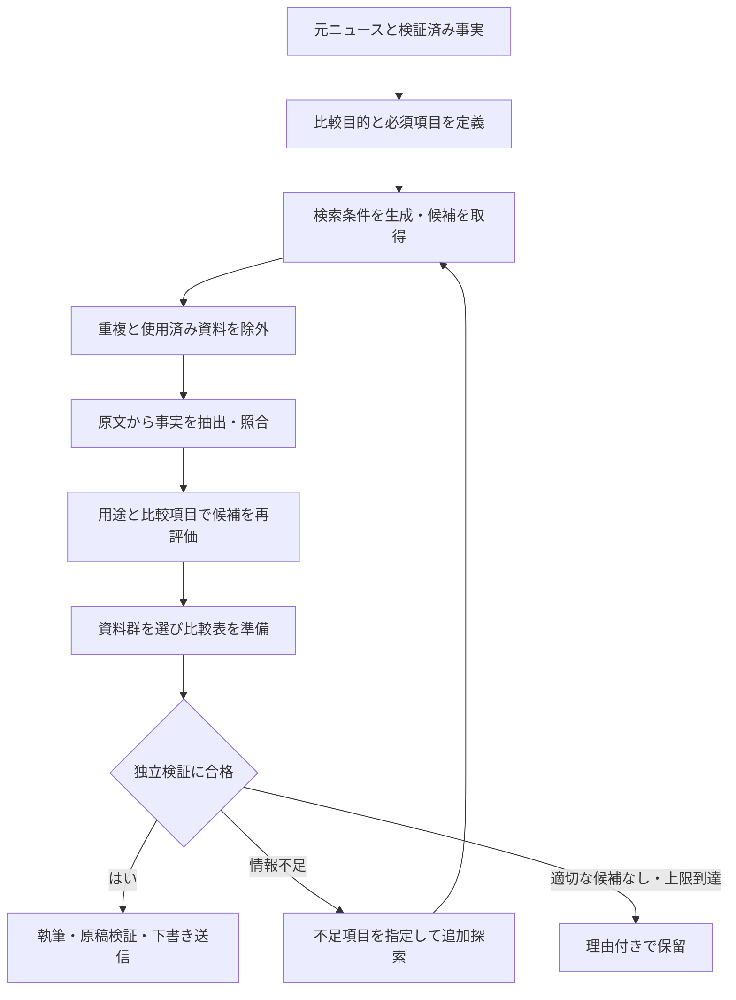

# 比較記事の資料選択を改善する計画

作成日: 2026-10-10（日本時間）  
対象: `newsWeave` の比較資料探索・選択・比較表・検証処理  
状態: 並行評価と明示監査の記事連携を実装。本番自動経路は未切替（下記の進捗を参照）
> 設計更新（2026-10-10）：資料群と比較観点を共同で探索する[新設計](comparison-joint-discovery-design.md)を追加した。探索前の比較質問の固定と、その充足による候補の早期排除は、新設計の複数資料群・仮説の評価へ見直す。品質・根拠・過半数・権利・重複・送信条件は維持する。以下の実装・評価記録は当時の方式による履歴として保持し、新方式の実装完了や合格結果とは扱わない。

## 1. 目的と完了条件

元となるニュース資料のテーマと根拠付き事実から比較の目的を定義し、その目的に合う資料を検索・取得・AI処理して選択する。読者が同じ課題に対する製品・サービスの選択肢を判断できる記事を作る。

比較対象には特徴の違いが必要である。ただし、その違いは「同じ問いに対する異なる回答」である必要がある。IoT、クラウド、AIといった広い分野の一致だけで採用しない。

改善完了の条件は次のとおりとする。

- 採用したすべての製品について、同じ用途で比較する理由と、原文または検証済み事実への参照を記録できる。
- 執筆前に比較の問いと必須項目が確定し、各セルが同じ問いに回答している。
- 必須の主要比較項目は全製品で根拠を確認する。その他の表示項目も過半数の比較対象で特徴を確認する。
- 従来の「すべての比較項目で、比較対象の発表資料の過半数に特徴が示される」という条件を維持する。
- 不足する必須項目を削除して合格させず、追加探索または候補の入れ替えを行う。
- 適切な組み合わせが見つからない場合は保留し、件数を満たすための比較記事を送信しない。
- 新しい選択処理・既存の事実検証・原稿検証をすべて通過した記事だけを下書き送信する。

本計画の成果物は設計・実装・評価・段階的導入とする。既存WordPress下書きの自動書き換えは導入に含めず、再評価結果を提示した後の別作業とする。`newsCollection` の airlabs.jp 用設定と運転環境には適用しない。

## 2. 現状確認と改善する理由

2026-10-10時点のソースコードを確認した。

| 現在の仕組み | 問題 | 改善方針 |
| --- | --- | --- |
| テーマ分類は主に語彙ルール | 大きな用途・環境・機能カテゴリの一致が、具体的な代替可能性を示すとは限らない | 根拠付きの用途・製品種別・利用者・判断課題をAIで構造化する |
| 比較軸は両側に関連語・値があれば共有軸として数える | 異なる役割の機能でも同じ軸として数えられる | 同じ質問に回答する事実かを評価する |
| 表は `hardware_spec` など事実の型で行を作る | 「技術・機能仕様」セルに異なる特徴が並び、横に比較しにくい | 具体的な機能・条件を単位とする比較項目を作る |
| 登録済み資料を探索し、必要に応じて収集元を更新する | 比較の問いや不足項目を用いた外部検索が十分でない | 検索計画と検索アダプターを追加する |
| 探索時の `query` は元資料のタイトル | 用途・同義語・不足項目を反映した複数検索になっていない | テーマ・比較項目から検索条件を生成する |
| 候補は事実確認前の順位で探索し、資料群は充足条件で選ぶ | 事実確認後の意味的適合度を含む組み合わせ最適化が弱い | 抽出後に再順位付けし、資料群全体を評価する |
| 事実抽出は最大24件を指示 | 比較に重要な仕様が多い資料では必要項目が抽出枠から漏れ得る | 不足する項目に限定した追加抽出を行う |
| 12項目の原稿検証 | 今回のように合格しても比較の判断材料として弱い記事が残る | 執筆前の比較適性検証と、表の項目ごとの意味的検証を追加する |

現在の3記事を評価用の記録として保存する。

- 投稿5746: MCP接続で公的情報を扱う業務支援サービス視点。
- 投稿5747: 現場データ起点の自動化・監視・換気制御の設計軸。
- 投稿5748: Web脆弱性診断サービスの診断方式と改修支援。

3件を一律に不適切と決めるのではなく、どの候補・比較項目が妥当かを個別に評価する。特に5747は、ワークフロー、通信機器の監視、換気設備の制御という役割の差を検出できるかを確認する例とする。

## 3. 処理の全体像

各工程の入力・出力・モデル・設定・根拠・判定理由を保存する。中断した場合は確定済み工程から再開し、資料取得やAI呼び出しを無条件にやり直さない。

## 4. 比較目的と比較項目の設計

### 4.1 元資料から作る比較計画

AIに原文と検証済み事実を渡し、次を構造化して返させる。

- 主たる製品・サービスとその種別。
- 主たる利用者、利用環境、解決する課題。
- 読者が選択するための問い。例: 「現場イベントを条件判定し、通知・業務処理を実行する基盤を選ぶ」。
- 比較対象となる製品の役割と、除外する役割。
- 必須の主要比較項目と補助項目。
- 各項目の質問、回答の形式、適用条件、必要な根拠。
- 用途を確認するために不足している情報。

主要比較項目は当初3〜5項目を目安とする。項目数を増やすこと自体を目標にせず、選択を左右する問いを優先する。必須項目を満たさない候補に合わせて、計画を自動的に緩めない。

AIの計画は分類・編集上の判断であり、新しい製品事実ではない。原文に根拠のない機能・用途・対象者を計画の事実欄へ追加することを禁止する。元資料の用途が曖昧なら追加資料の取得または保留とする。

### 4.2 比較項目の例

以下は設計例であり、各製品が対応していると主張するものではない。元資料に照らして確定する。

| 比較テーマ | 具体的な比較項目の例 | 採用を避ける組み合わせ |
| --- | --- | --- |
| 現場イベントを使うワークフロー基盤 | 入力イベント、条件分岐、実行アクション、外部連携、実行履歴 | 通信ルータ監視や換気制御と、ワークフロー基盤を代替候補として扱う |
| 公的情報に接続するAIサービス | 対象情報、取得・検索方法、出典の追跡、認証、利用量と料金条件 | 情報の取得目的が異なるサービスを、MCP対応だけで同等と扱う |
| Webアプリケーションの脆弱性診断 | 診断入力、検査方式、人による確認、報告内容、修正確認、改修支援 | 診断サービスと開発・保守一体型サービスの契約条件の差を無視する |

補完関係にある製品は、通常の代替候補の比較から除外する。構成要素や役割を整理する記事を作る場合は、別の編集目的として明示し、今回の比較適性条件を回避するために記事種別を変更しない。

## 5. 検索・取得・追加抽出

### 5.1 検索方法

元資料の製品名だけでなく、用途・役割・主要機能・同義語・不足項目を検索条件に含める。

1. ローカルの取得済み資料から候補を検索する。
2. 元資料から作った検索語で、外部のニュース発表・提供元の一次資料を発見する。
3. 比較項目が不足する候補について、公式機能説明・仕様書・料金ページを追加探索する。
4. 検索結果の断片ではなく取得した原文から事実を抽出し、原文一致と意味を確認する。

既存の `ResearchAcquisitionPort` とキュー処理を拡張し、検索サービスを交換できるアダプターとして実装する。検索サービス・認証・料金・実行環境での利用可否は実装前に確認する。未設定や利用不能の場合は登録資料内に探索範囲を限定したことを記録し、必要な資料が不足すれば保留する。

取得は既存のホスト・URL制限、収集条件、robots確認、リクエスト間隔、サイズ制限を通す。検索で発見した新しいホストを自動的に承認済み扱いにしない。未登録の公式サイトは、既存の登録・収集可否確認の手順に乗せる。

### 5.2 使用済み資料の除外

既存下書きで使った資料を除外する依頼では、候補探索前と下書き送信前の両方で確認する。

- WordPress下書きの出典と、ローカルの原稿・改訂履歴の出典を照合する。
- 正規化URLだけでなく、同一本文、転載、同一発表の別URLも重複として扱う。
- 今回作る記事同士の資料重複も確認する。
- 比較対象・補助資料の双方に除外条件を適用する。共通仕様書などを勝手に例外扱いしない。
- 除外記録はバッチ開始時の基準と送信直前の確認結果を分けて保存し、並行作業で使用された資料も検出する。

再利用禁止を全運転に適用するか、依頼されたバッチに適用するかは設定として分離する。今回のような依頼の条件は当該バッチに必ず引き継ぐ。

### 5.3 複数資料と抽出不足の扱い

1製品に複数の公式資料を結び付け、ニュース・機能説明・料金表の役割を記録する。URL数と製品数を別々に管理し、同じ製品の3ページを3製品の比較と数えない。

既存の発表資料の過半数条件は別に検証する。補助資料に記載があっても、その記載がない発表資料を「記載あり」に変換しない。発表資料側の条件に達しなければ、適切な発表資料を選び直すか保留する。

主要項目の抽出漏れが疑われる場合は、その項目を指定して追加抽出する。追加した事実も原文の引用範囲・値・条件を検証し、過去の抽出結果を上書きせず改訂として記録する。

事実ごとに製品・プラン・版・提供地域・現在提供中／予定・確認時点を保持する。互いに矛盾する記載は不確実性として残し、AIが推測で解消しない。

## 6. 候補の採用基準と資料群の選択

### 6.1 必須条件

候補をAIで評価し、以下をすべて満たす場合のみ採用可能とする。

- 主たる用途、製品の役割、利用者の判断課題が比較目的に適合する。
- 必須の主要比較項目へ、確認済み事実で回答できる。
- 発表対象の製品自身の機能である。企業全体の事業や別製品の能力を混ぜない。
- 根拠となる事実IDと原文を提示できる。
- 使用済み資料・同一内容・同一製品の重複条件に抵触しない。
- プランや利用条件の差を示せる。条件が異なる性能・料金を同条件の優劣として比較しない。

評価結果は「採用可能」「追加情報が必要」「不適合」に分ける。AIの評価点が高くても、必須条件の不合格を相殺しない。分類根拠や事実参照が無効な回答は採用せず、修復または保留とする。

### 6.2 再順位付けと組み合わせ評価

事実抽出後に、用途の適合、同じ問いへの回答可能性、条件の明確さ、資料の鮮度・粒度から候補を再順位付けする。最初に見つかった候補だけで確定しない。

資料群は、元製品への個別適合に加え、候補同士の役割・用途・必須項目の整合も評価する。製品数を増やすことや大きな特徴数より、読者の判断に使える組み合わせを優先する。

初期設定は比較対象3製品を基本とし、`comparison_min_sources` のURL数条件とは別に製品数を検証する。主要項目の全製品充足、表示項目の過半数充足、発表資料の過半数条件を満たす資料群を選ぶ。

不足した項目の名前と候補の役割を使って追加探索する。元資料から確定した必須項目を落として合格させない。計画を変更する場合は、候補に合わせるための変更ではなく、元資料の追加根拠に基づく変更として理由と改訂を記録する。

## 7. 比較表と独立検証

比較表は事実の型ではなく、比較計画の具体的な項目から作る。各セルに短い回答と出典参照を付け、根拠となる事実IDを内部に保持する。

- 例: 「入力イベント」の全セルは入力の種類を回答する。「外部連携」のセルへ導入実績を混ぜない。
- 未記載、明示的な非対応、条件付き対応、提供予定、条件が揃わず比較不能を区別する。
- 数値の換算や料金比較は単位・税・契約条件を明示し、未確認の計算や推測をしない。
- 元の事実と引用は保持し、短いセル表現は検証可能な編集表現として保存する。

執筆前に、選定・比較計画とは別のAIモデルで資料群と比較表を検証する。独立検証は次を必須条件とする。

1. 同じ選択課題に対する比較対象として適切か。
2. 各項目が選択判断に役立ち、各セルが同じ問いに答えているか。
3. 主要項目の全製品充足と、その他の過半数条件を満たすか。
4. 根拠・値・条件・発表時点が整合しているか。
5. 採用理由が後付けの広い共通点に依存していないか。

通過後に本文を作る。本文は製品紹介の繰り返しを抑え、項目ごとの違いと用途別の選択条件を説明する。根拠のないおすすめ順位は付けない。既存の「短い導入 → 比較表 → 比較の考察 → 出典 → 使用したAIモデル」の構成を維持する。

執筆後も同じ比較目的と表の整合を確認する。既存12項目に加えて新しい検証条件を明示し、件数・スキーマ・送信ゲートを整合させる。旧原稿が新基準に合格したと自動的に見なされないよう、検証方針の版を保存する。

## 8. 主な変更箇所

以下のファイル名・データ型名のうち「追加」は実装時の提案であり、現在の機能ではない。

| 箇所 | 変更内容 |
| --- | --- |
| `app/contracts/comparison_analysis_v1.py` と追加の計画・評価契約 | 比較目的、具体的項目、製品別資料、セル根拠、採否理由、独立検証の構造を定義 |
| `app/contracts/editorial_v1.py` | ResearchRequestへ計画ID・複数検索条件・不足項目・除外方針を渡す |
| `app/modules/research/topics.py` | 語彙分類を候補の粗い絞り込みに使用し、最終採用の十分条件にしない |
| `app/orchestration/comparison_analysis.py` | 用途・役割・比較の問いに基づくAI評価と、根拠の決定的検証を追加 |
| `app/modules/comparison/analysis.py` | 広い語彙の一致から、具体的な項目と事実の対応へ移行 |
| `app/orchestration/research.py` | 検索計画、追加探索、抽出後の再順位付け、資料群評価、保留・再開を実装 |
| `app/modules/acquisition/ports.py`、`app/infrastructure/research_requests.py`、追加の検索アダプター | 検索結果の発見と、確認済み原文の取得を分離して既存キューへ接続 |
| `app/ai/runner.py`、`app/core/config.py`、`compose.yaml` | 比較計画・候補評価・独立検証のAI処理、モデル、上限、設定を追加 |
| `app/contracts/article_package_v1.py`、`app/contracts/comparison_v1.py` | 比較計画とセル根拠を原稿用パッケージへ引き継ぐ |
| `app/core/article_tables.py` | 具体的な比較項目から表を生成し、製品別・資料別の充足を別々に検証 |
| `app/orchestration/editorial.py`、`app/orchestration/editorial_jobs.py` | 執筆前の適性検証、改訂・待機・再開、手動指定候補への同じ判定を接続 |
| `app/modules/verification/service.py`、`app/orchestration/publication.py` | 新しい比較品質の検証結果を送信条件に追加 |
| `app/orchestration/model_disclosure.py` | 比較資料の選定・評価に使用したAIの実行履歴を記事のモデル表記へ反映 |
| DBモデル・必要な移行ファイル | 計画、評価、セル根拠、版・ハッシュ、除外基準の保存。既存履歴は保持 |

新しい契約は版と入力ハッシュを持つ。テーマ分類、事実抽出、候補評価、執筆、検証の責務を分ける。旧契約の読取互換性を保ち、新計画なしの旧記事が新経路へ無条件に進まないようにする。

## 9. 実装順序

| 段階 | 作業と成果物 | 完了条件 |
| --- | --- | --- |
| 1: 評価基準 | 比較適性の評価表、現在の3記事の評価、良い・悪い比較例を固定 | 採否と根拠を人が確認でき、曖昧な基準を整理できる |
| 2: 計画と記録 | 比較計画、具体的項目、採否結果、除外基準の契約と保存を追加 | 原文に根拠のない分類・回答が記録上検出される |
| 3: 登録資料での選択改善 | AIによる意味的評価、追加抽出、再順位付け、資料群評価を追加 | 広いカテゴリ一致だけの誤採用を防ぎ、適切な登録資料が選ばれる |
| 4: 比較表と送信条件 | 具体的項目の表、執筆前の独立検証、原稿検証と送信ゲートを追加 | 不適切な資料群から執筆・送信へ進まない |
| 5: 外部検索 | 検索アダプター、公式資料取得、不足項目による追加探索を追加 | キーワードに不足項目を反映し、取得原文から根拠を確認できる |
| 6: 試験運転 | 生成AI・IoT・セキュリティで比較し、旧方式との差を記録 | 下記の受入基準を満たし、モデル費用・待機・再開も検証できる |
| 7: 導入 | newsWeaveへ設定で有効化し、下書きで確認 | サーバー正常稼働、履歴保持、newsCollection分離、再送の重複防止 |

段階3と4を最初の実用単位とする。外部検索だけを先に追加しても、候補選択の基準が弱いままなら同じ問題が残るため、意味的評価と送信ゲートを先に整える。

## 10. テスト・評価と受入基準

### 10.1 決定的な回帰テスト

既存の比較・探索・表・送信テストを拡張する。

- IoTという語が共通でも、異なる役割の候補を採用しない。
- 同じ用途で方式が異なる製品を、特徴が一致しないという理由だけで除外しない。
- 複数公式ページが同じ製品に属する場合、製品数や資料の多数票を水増ししない。
- 根拠のないAI分類、存在しない事実ID、別製品の事実を含むセルを拒否する。
- 必須項目不足では追加探索へ進み、項目を消して合格させない。
- 予定機能・上位プラン・補助適用価格を一般機能・通常価格へ混ぜない。
- 使用済みURL、転載、同一本文、並行作業による使用済み化を検出する。
- 手動指定した比較候補にも同じ検証を適用し、不適切なら理由付きで停止する。
- 一時エラー・使用量上限・モデル未設定から再開でき、確定済み工程と送信を重複させない。
- キャッシュされた計画は資料・事実・方針の版が変わった場合に再評価される。
- 旧原稿・既存下書き・newsCollection用データを自動改変しない。

### 10.2 比較品質の評価

最低20組の候補ペアと6組以上の資料群を、生成AI・IoT・セキュリティに分けて用意する。適切、不適切、情報不足、補完関係、条件差、抽出漏れの例を含める。開発で使う例と最終判定用の例を分け、今回の3記事への過剰適合を避ける。

人が確認した採否と、AIの採否・理由・根拠を照合する。以下は初期の受入目標であり、達成を保証する値ではない。

- 明確に役割が異なる不適切例を100%排除する。
- 最終評価で採用した候補のうち、人の評価でも適切な割合を90%以上にする。
- 表示されたすべてのセルで根拠が有効であり、各セルが比較項目に回答している。
- 適切な候補が存在する評価例を過剰に保留しない。採用精度と併せて候補の取りこぼし率・保留率を報告する。
- 新たに試作する3記事は、それぞれ人が確認できる採用理由と比較表を持ち、独立検証と原稿検証を通過する。
- 「無理な比較が減ったか」「同じ項目で読み比べられるか」「選択条件が分かるか」を人が判定する。AIの合格件数だけを品質の代用にしない。

意味的な品質評価に失敗した場合は、主に比較目的・候補の役割判定・比較項目への対応を修正する。語彙を追加して失敗例だけを通す修正は避ける。

## 11. 運用・費用・導入後の確認

- AI計画・抽出・評価・検証は必要な入力範囲に限定する。実行履歴から呼出回数、トークン、処理時間、検索費用を測る。
- 初期の上限案は外部検索8回、原文取得20ページ、詳細AI評価8候補、追加探索2巡／元記事とする。設定可能にし、実測を基に調整する。上限到達は品質基準を緩める理由にしない。
- 新しい検索履歴・評価履歴は入力ハッシュと方針の版でキャッシュする。古い資料の再利用は除外条件と鮮度条件を毎回確認する。
- AI選定結果に根拠がない、検証AIが使えない、探索上限に達した場合は具体的な理由付きで保留する。
- 実行設定で旧方式／新方式の切り替えを可能にし、最初は送信しない並行評価で比較する。新方式の検証が失敗した記事を旧方式へ自動迂回して送信しない。
- 導入はnewsWeaveに限定する。既存の運用サービスの停止時間を抑え、DB移行・再開・重複防止を確認する。
- 導入後は新しい下書きで、採用理由、表の粒度、原文との一致、モデル表示、WordPress保存状態を確認する。

## 12. 既存3記事の扱いと次の作業

まず現在の3記事を新基準で再評価し、比較目的・候補の採否・不足項目をまとめる。既存本文の言い換えだけで問題を解消したと扱わない。候補の差し替えが必要なら、旧記事で使っていない資料を選ぶ依頼条件も維持して新資料を探索する。

直近の着手対象は、段階1の評価基準と段階2の契約設計である。その成果を使い、段階3・4を実装して登録済み資料で改善効果を確認し、段階5で不足資料の検索を拡張する。

計画書の初版作成時点では実装変更を行っていなかった。以降の進捗は次節に記録する。既存WordPress下書きは変更していない。

## 13. 実装進捗（2026-10-10）

実装対象はnewsWeaveのみ。実装詳細とコマンドは[並行評価の実装記録](comparison-selection-shadow.md)、
評価基準と既存3記事の編集評価は[再評価記録](comparison-selection-evaluation-20261010.md)を参照。

| 段階 | 現在の到達点 | 未完了の条件 |
| --- | --- | --- |
| 1 | 判定基準・良い／悪い比較条件と、既存3資料群の根拠付き暫定評価を記録 | 人による採否の最終確認、20ペア・6群以上の受入データ |
| 2 | 計画・固定必須質問・候補評価・セル根拠・除外基準・独立検証の契約、追記保存、版・ハッシュと工程再利用を追加 | 本番の探索・記事パッケージへの引継ぎは後続段階 |
| 3 | 明示指定した登録資料へのAI意味評価、抽出済み事実での再順位付けと資料群選択をshadow CLIに追加 | 自動候補探索、不足箇所の追加抽出、追加探索、複数公式ページの取得・紐付け |
| 4 | 具体項目の比較表、別モデルの独立5条件、shadow設定時の全送信拒否を追加 | 本番の執筆・原稿検証・送信ゲート、新しい検証件数・版への接続 |
| 5〜7 | 未着手。外部検索未設定を評価記録に明示 | 検索接続、意味的受入評価、3試作記事、段階導入 |

全体回帰はPostgreSQLの一時スキーマで712件成功、3件スキップ。
最後のAI出力指示修正に関連する38件も成功。RuffとMypy（107ファイル）は成功。
既存3資料群の実AI評価はすべて保留であり、品質目標を達成したとは扱わない。
5747は役割が異なる監視・換気制御の候補を除外。5746は重複資料として評価開始前に停止、
5748は不足必須項目の申告不整合でAI出力を拒否した。
実AIでの独立検証合格や、新記事の受入確認はまだない。

既存9資料に対応する原稿・記事パッケージ・送信記録・事実とItemの状態／版は、最終評価前後のhashが一致。
newsCollectionの設定2ファイルのhashも作業前と一致。newsWeaveの.envと稼働サービスは切り替えていない。

## 14. 下書き送信依頼への追加対応（2026-10-10 19時台）

比較選択監査を明示して記事を作る連携を追加した。`ArticlePackageV1.comparison_selection` がある場合は、具体質問の比較表を使用し、保存済み監査・現在の原文／事実・実際のAI実行記録と独立モデルを執筆・送信時に再確認する。既存12項目の原稿検証を保持し、この経路の検証版は `verification-v10+selection-v1` とする。WordPressのモデル表示も計画・候補評価・独立検証の実行記録に基づく。shadow設定の全送信拒否は維持する。監査の合格だけでは送信を許可せず、原稿の合格も必要となる。

比較計画には根拠のある編集目的を任意で指定できる。指定や方針が変わる場合は新しい版・入力ハッシュとして保存し、既存計画の必須項目は削除しない。候補には事実IDごとの保持必須条件を渡し、通貨・税区分等の欠落を拒否する。質問中の例示を全機能の同時要件と誤解したり、計画が明示した代替役割を提供方法の違いだけで除外したりしないよう指示を修正した。

初回の事実抽出が旧検出器で保留された資料について、現行の権利・品質・注入検知を通り、現行版の重複判定がすべて `separate` の場合だけ通常の抽出を再開できるよう修正した。重複・要確認の判定は解除しない。

今回のWordPress送信結果は **0件、保留**。既存WordPressとローカル改訂履歴の32 URLを除外し、登録済み資料を確認した。承認済みのPR TIMES収集経路で3資料も追加取得したが、適切な3製品群は成立していない。CyberCrew・Safership・セキュサポの資料群は独立比較適性検証で不合格だった。セキュサポの資料には具体的なWeb診断対象の根拠がなく、候補セルの推測は採用できない。IssueHuntとShisho Cloudの確認資料にも危険度評価基準等の不足があり、SentinelSecurityは対象・役割・検査方法の適合に課題が残る。必須項目を削除したり旧方式へ迂回したりして送信していない。

再開には、同じ診断選択課題に対して、対象・検査方法・報告内容・課金基準・危険度評価を確認できる未使用資料の組み合わせが必要である。監査とAI実行IDは `.local/wordpress-draft-preparation-20261010.json` に保存した。新しい原稿・記事パッケージ・WordPress投稿は作成していない。

SQLite/PostgreSQLを含む全体回帰は730件成功・3件スキップ。最後の比較指示・入力変更に関係する65件も成功。RuffとMypy（108ファイル）は成功。API・schedulerの稼働コンテナは切り替えていない。newsCollectionの.envとcompose.yamlは作業前のhashと一致する。段階5〜7の自動探索・意味的受入評価・3試作記事・本番切替は引き続き未完了である。

## 15. 資料群と比較観点の共同探索への設計更新（2026-10-10）

ユーザーとの検討を踏まえ、[資料群と比較観点を共同で探索する設計](comparison-joint-discovery-design.md)を作成した。関連資料の検索、用途・役割による絞り込み、複数の3資料群の提案、群ごとの比較目的・項目の試作、根拠・条件・有用性・重要情報の欠落の評価を繰り返し、独立検証に通った計画を執筆前に確定する。

料金や危険度の評価基準を全テーマの必須項目として固定しない。一方、確定計画の主要項目は全製品、表示項目は製品・主発表の双方で過半数の根拠を必要とする。試作計画の変更理由を記録し、不足項目の削除や目的のすり替えによる見かけの合格を防ぐ。

新設計の契約・検索・索引・予算・段階導入は提案であり、この文書更新で実装・DB移行・稼働設定変更・追加資料取得・再評価・WordPress送信は行っていない。第14節と16資料の旧方式による不成立は、その固定項目についての結果であり、別観点の記事成立を否定する結果ではない。今後の設計・実装では新設計を優先し、過去の評価・既存下書きは保持する。
