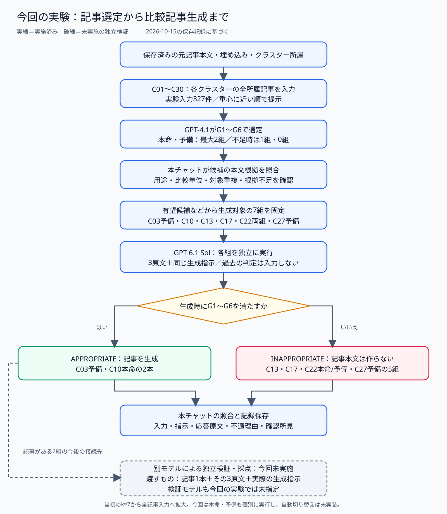
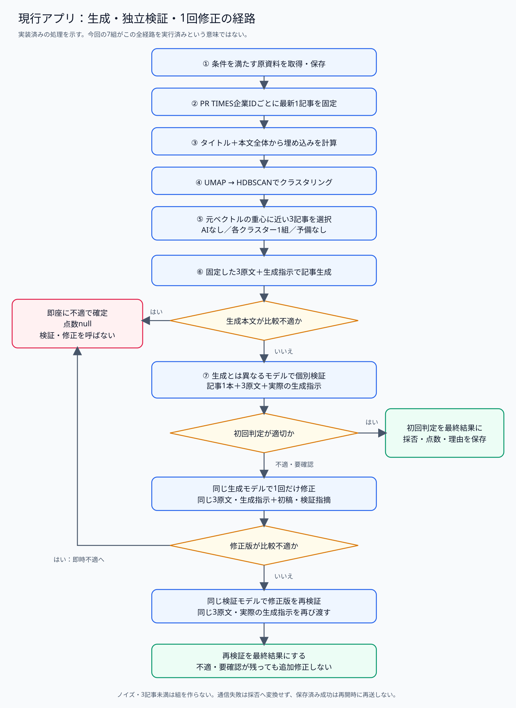

# 記事群から比較記事生成・検証までの流れ

確認日：2026年10月15日。

**今回の実験では、GPT-4.1による候補選定と、GPT 6.1 Solによる生成・生成時の適否判定まで完了した。別モデルによる独立検証は、まだ実行していない。** 一方、現行アプリには、重心に近い3記事を選び、生成後に別モデルで検証・必要なら1回修正する経路が実装されている。両者を分けて説明する。

## 1．今回実施した、保存済み記事群に対する実験

図の実線は実施済みの処理、破線は今回未実施の独立検証を示す。[PNG版](experiment-flow.png)と[編集用Mermaid](experiment-flow.mmd)も保存した。

### 入力と候補選定

保存済みの元記事本文、埋め込み、クラスター所属を使用した。今回の選定実験で入力したのはC01〜C30の所属記事で、C01が13件、C02が11件、C03〜C10が93件、C11〜C30が210件、合計327件である。この327件は実験で扱ったクラスター所属記事数であり、取得済み記事全体の件数を表すものではない。

当初は、クラスターの重心に近い7記事だけをGPT-4.1へ渡す方法をC01で試した。その後はユーザーの指示により、各クラスターの全所属記事を入力する方法へ広げた。全記事入力でも重心への近さの順で提示するが、比較の適切さを優先するよう指示している。重心にはUMAPの座標ではなく、元の埋め込みベクトルを使う。

選定モデルは`gpt-4.1-2025-04-14`。本文を読み、比較に適した3記事組を本命・予備の最大2組返す。適切な組が不足する場合は1組・0組も認める。同じ3記事を並べ替えただけの組は予備にならない。予備と本命で一部の記事が重なることは認める。

| 基準 | 確認すること |
| --- | --- |
| G1 | 3つの異なる比較対象を明確に特定できるか |
| G2 | 具体的なカテゴリと比較する単位がそろうか |
| G3 | 同じ読者・利用目的に対する代替候補か |
| G4 | 全3対象に本文根拠がある、有用な共通比較軸が3つ以上あるか |
| G5 | 選択に関わる違いを2軸以上で説明できるか |
| G6 | 時期・地域・プラン・料金・測定条件をそろえられるか |

GPT-4.1が返した候補を本チャットで本文と照合し、用途の混在、対象の重複、別製品の機能の混在、根拠不足などを確認した。そのうえで、有望候補と条件整理が必要な候補から、次の7組を生成対象とした。全クラスターの全候補を自動で生成へ回したわけではない。

### GPT 6.1 Solによる生成と結果

生成モデルは`gpt-6.1-sol`、推論設定は`medium`。各組に元記事3本の全文と同一の生成指示を渡した。以前の生成記事・判定理由や、他の組への応答は入力していない。

モデルは執筆前にG1〜G6を再確認する。条件を満たせば比較表・考察・条件別の選び方を含む記事を返す。条件を満たせなければ`INAPPROPRIATE`とし、不合格条件・理由・比較に必要な追加情報を返して、記事本文は生成しない。

| 対象 | 入力記事ID | 生成時の判定 |
| --- | --- | --- |
| C03・予備 | F865・F456・F932 | APPROPRIATE：記事生成 |
| C10・本命 | F950・F677・F698 | APPROPRIATE：記事生成 |
| C13・本命 | F438・F065・F637 | INAPPROPRIATE：比較単位・代替性・根拠の問題 |
| C17・本命 | F488・F333・F411 | INAPPROPRIATE：診断対象・比較単位・根拠の問題 |
| C22・本命 | F730・F903・F831 | INAPPROPRIATE：共通比較軸・差異の根拠不足 |
| C22・予備 | F730・F903・F673 | INAPPROPRIATE：同じ根拠不足が残る |
| C27・予備 | F902・F711・F278 | INAPPROPRIATE：対象機種の仕様を固定できない |

7件ともAPIの応答は正常に完了した。5件の不適は通信エラーではない。生成後、本チャットが出典段落・対象機種・数値条件などを照合し、原文と確認所見を分けて保存した。

当初の運用案は「本命が不適なら予備で生成」である。今回の比較実験では、7組をそれぞれ独立したリクエストとして実行し、C22は本命・予備の両方が不適となった。アプリに本命・予備の自動切り替えを実装したわけではない。

### 検証の実施状況

生成モデル自身の適否判定、本チャットによる本文照合、別モデルによる独立検証は異なる。

今回完了したのは前の2つである。**C03・C10の生成記事に対する別モデルの独立検証、絶対評価点の付与、検証指摘に基づく修正・再検証は未実施**。独立検証モデルもこの実験では指定していない。

独立検証へ進める場合には、記事1本、その入力元の3記事全文、生成時に実際に使った指示全文を渡す必要がある。今回の実験指示と現行アプリの指示・採否基準には違いがあるため、実験記事を現行指示で生成されたものとして扱わず、実際に使った指示で検証する。

詳しい結果：[GPT 6.1 Solの実行報告](../promising-comparison-gpt61-sol-20261015/report.md)、[記事・不適理由の全文](../promising-comparison-gpt61-sol-20261015/results-all.md)。

## 2．現行アプリに実装されている処理

この図は実装済みの経路を示し、今回の7組がこの全経路を通過したという実行記録ではない。[PNG版](implemented-pipeline-flow.png)と[編集用Mermaid](implemented-pipeline-flow.mmd)も保存した。

| 段階 | 処理と受け渡すもの |
| --- | --- |
| ① 取得・保存 | PR TIMESの公式種別「商品サービス」、AI／IoTの記載、タイトル除外条件を確認し、適格な原資料をスナップショットとして保存する。現在の保存済み記事から始めるなら、この取得済み資料が入力になる。 |
| ② 企業ごとの整理 | PR TIMES企業IDごとに公開日時が最新の1記事を選び、その実行で使う記事IDを固定する。 |
| ③ 埋め込み | 「タイトル＋空行＋本文全体」を埋め込む。長文は分割して統合し、本文を切り捨てない。既定モデルは`text-embedding-3-small`。新しい実行では計算し、同じ実行の再開では完了済みを再送しない。 |
| ④ クラスタリング | UMAPで縮約後、HDBSCANで分類する。ノイズと所属記事3件未満のクラスターからは比較組を作らない。 |
| ⑤ 3記事選択 | 各クラスターの元の埋め込みの重心に近い3記事を、AIなしで1組選ぶ。現行実装には本命・予備の2組選定はない。 |
| ⑥ 生成 | 固定した3原資料全文と生成指示を生成モデルへ渡し、記事本文を得る。比較不適なら所定の不適報告を返す。 |
| ⑦ 独立検証 | 生成モデルと異なる検証モデルへ、記事1本・3原資料全文・実際の生成指示全文を渡す。採否・点数・理由を返す。 |

生成本文が「比較不適（公開不可）」なら、検証・修正を呼ばず即座に不適で確定する。評価モデルが採点していないので点数は`null`になる。

通常の記事は別モデルが個別検証する。適切なら初回判定を最終結果にする。不適・要確認なら、その理由を同じ生成モデルへ渡して**1回だけ**修正し、同じ検証モデルで再検証する。修正時も同じ3原資料と実際の生成指示を使い、記事を選び直さない。修正版が比較不適なら即時確定し、それ以外は再検証結果を最終結果とする。2回目の修正はしない。

検証結果は`eligible`／`ineligible`／`needs_confirmation`、0〜100の点数、理由で保存する。点数だけで採否を覆さない。現行仕様では書式を含む不備を確認すると不適とし、比較表の未記載項目には所定の減点を適用する。今回の実験の厳格な同カテゴリ条件を、そのまま現行アプリの基準として説明しない。

現在の設定ファイルの既定値は、生成が`gpt-4.1-mini-2025-04-14`、検証が`gpt-4.1-2025-04-14`。実行時の設定で固定する値であり、今回の実験で使った`gpt-6.1-sol`と区別する。

## 3．中断・保存・再開の扱い

現行アプリは原資料、実行対象、埋め込み、所属クラスター、選んだ3記事、初稿、初回判定、唯一の修正版、再検証結果を保存する。正常保存済みの結果は、同じ実行の再開で呼び直さない。

通信失敗や不正応答は正常な不適判定に変換しない。修正要求は送信前に予約を保存し、応答が保存できなかった場合は再開しても修正要求を再送しない。API送信後・応答保存前の中断まで含む完全な一回実行保証とは区別する。

今回の実験はアプリ本体のDB経路とは別に、入力スナップショット・ハッシュ・指示・API要求／応答・記事・判定をファイルへ保存した。今回の資料作成とcommit再開ではモデルAPIを呼び直していない。

## 根拠と図の編集

現行実装についてはnewsWeaveリポジトリの`docs/seven-stage-system-design-20261015.md`、`app/pipeline.py`、`app/clustering.py`、`app/model_client.py`、`app/settings.py`を確認した。今回の実行結果は、保存済みの各クラスターの選定記録とGPT 6.1 Solの実行記録に基づく。

図はSVG・PNGで閲覧でき、Mermaidファイルから構造を編集できる。SVG／PNGは同じ内容の固定レイアウト図である。説明と図の対応、入力件数、最新の生成判定、原資料・実装ファイルのハッシュを[根拠記録](basis.json)に保存した。
