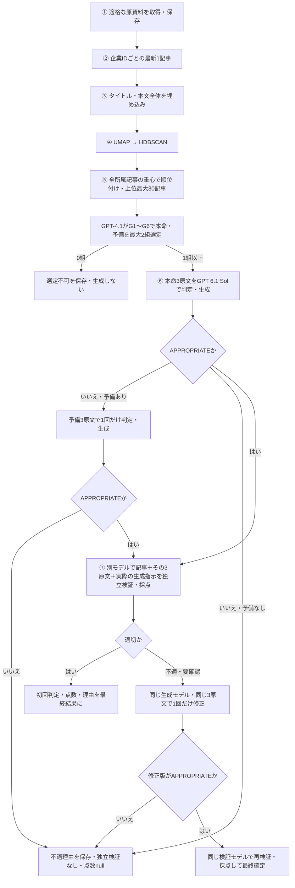
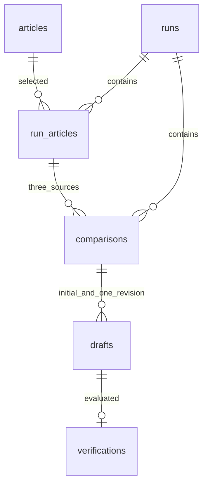

# News Weave：7段階のシステム設計

このシステムは原資料の取得から比較記事の個別検証までを7段階で処理する。本書を実装仕様とし、モデル指示の正本はapp/promptsに置く。

## 1. 処理の全体像

⑤では各クラスターから本命・予備の最大2組をAI選定する。⑥の本命の初回判定がINAPPROPRIATEなら、予備があるときだけ予備を使う。APPROPRIATEになった記事は必ず⑦へ進む。生成時の自己判定だけでは最終採用にしない。⑦が不適・要確認なら、同じ組のまま1回だけ修正・再検証する。検証不適を理由に予備へ切り替えたり、2回目の修正をしたりしない。

実行結果はMarkdownとJSONへ出力する。選定不可、各組の生成不適理由、成功した記事、独立検証の採否・点数・理由を区別する。WordPress投稿や画像生成は本処理の範囲外。

## 2. 各処理の責務

### ① 記事の取得

以下の条件を全て満たす公開記事のタイトル・本文・URL・公開日時・配信元企業IDを取得する。

- 公式の種類が「商品サービス」（種類ID 01）。本文中の自称やタイトルから種類を推定しない。
- タイトルまたは本文の導入部にAI／IoT分野の記載がある。会社概要だけの記載で受理しない。
- タイトルに指定の除外語を含まない。除外語は`app/title-exclusions.txt`の111語を使用する。本文だけの一致は除外理由にしない。

公開AI／IoT検索または指定された公開リリースURLから取得する。検索結果から公開記事に到達し、取得した公式HTMLで条件を確認する。

HTTPS、PR TIMESホスト制限、公開IP確認、DNS固定、転送先検査、robots.txt、Crawl-delay、取得間隔、応答サイズ・タイムアウトの制限を維持する。これは取得処理の基本動作であり、記事適性を判定する追加段階ではない。

公式企業リンクと記事URLの企業IDを照合する。公開日時は公式JSON-LDのdatePublishedを使用する。日時が日本時間表記ならUTCへ変換する。dateModifiedは使用しない。タイトルが文字化けしている場合は同じ公式HTMLの正常なメタデータを使い、欠損文字を推測しない。

受理した記事は原資料スナップショットとして保存する。同じURL・同じ内容は重複保存しない。内容が変わった場合は別スナップショットとし、過去の実行で使用した本文を書き換えない。

### ② 配信元の整理

保存済みの適格記事から、PR TIMES企業IDごとに公開日時が最新の1記事を選ぶ。公式社名が同じでも企業IDが違えば統合しない。日時が同じ場合はリリース番号、URLの降順で決める。同じリリースの複数スナップショットがある場合は取得日時の新しいものを使う。

選んだ記事IDを実行単位に固定してから③に進む。原資料全体を削除せず、実行の所属関係で対象を表す。

### ③ 埋め込み

②で選んだ記事の「タイトル＋空行＋本文全体」から埋め込みを計算する。既定モデルはtext-embedding-3-small。長文はUTF-8で6,000バイト以内の区間に分け、各区間の埋め込みをバイト数で加重平均し、L2正規化する。本文を切り捨てない。

各実行で埋め込みを計算して保存する。同じ実行を中断・再開するときは、完了済みの記事を再送信しない。

### ④ クラスタリング

正規化済みベクトルをUMAPで縮約し、HDBSCANで内容の近い記事を分類する。

| 設定 | 既定値 |
| --- | --- |
| UMAP距離 | cosine |
| UMAP次元 | 15 |
| 近傍数 | 15 |
| min_dist／random_state | 0／42 |
| HDBSCAN距離 | euclidean |
| min_cluster_size／min_samples | 5／5 |
| クラスター選択方式 | leaf |

④の出力は記事IDとクラスタラベルとする。⑤ではこの所属結果と③の埋め込みを参照する。ノイズは-1として記録し、⑤の対象にしない。データ数が指定されたアルゴリズムのパラメータを満たさない場合は処理エラーとする。

### ⑤ AIによる比較候補の選定

④の全所属記事について、③の元ベクトルをL2正規化し、その平均重心とのコサイン類似度で順位を付ける。重心は候補を絞る前の全所属記事から計算する。UMAP座標は使わない。同点は記事ID順とし、入力順に依存させない。

各クラスターの上位最大30記事の全文を選定モデルへ渡す。30記事以下なら全件を使い、ノイズと3記事未満のクラスターは呼び出さない。既定上限は30、設定で3〜30の範囲に下げられる。30超の設定は拒否する。30記事からの3記事組は最大4,060通りになるが、組み合わせ全件の本文を展開せず、30記事を1回の選定入力にする。

既定の選定モデルはgpt-4.1-2025-04-14。入力はcluster_idとcandidates。各候補にarticle_id、centroid_rank、タイトル、URL、公開日時、本文全文を含める。重心順位は補助情報であり、比較可能性を優先する。

選定指示の正本はapp/prompts/selection.txt。全条件を満たす本命と予備を最大2組返し、1組・0組も許す。

| 条件 | 必須内容 |
| --- | --- |
| G1 | 3つ以上の異なる対象が明確で、各原資料が実質的な情報を提供する |
| G2 | 同じ具体的カテゴリ・比較単位。異なるカテゴリの横断比較は不可 |
| G3 | 同じ読者・目的に対する代替候補。補完関係を混ぜない |
| G4 | 全3対象に根拠がある有用な共通比較軸が3つ以上 |
| G5 | 選択に関わる違いを2軸以上で説明できる |
| G6 | 時期・地域・プラン・単位・測定条件をそろえるか比較範囲を限定できる |

応答はselection_status（TWO_SETS／ONE_SET／NO_SET）、primary_article_ids、reserve_article_ids、reason。各組は候補内の異なる3ID、予備なしは空配列、本命なしは両方空配列。順序を替えただけの同じ3記事組を予備にしてはいけない。一部の記事の重複は許す。statusと件数の矛盾、候補外ID、重複ID、実質同一の2組は不正応答として停止し、選定不可や生成不適へ変換しない。

入力候補ID・順序、選定応答、組のID・順序をクラスターごとに保存する。0組も保存し、再開時に成功済み選定を呼び直さない。選定時の説明を生成・検証の事実補完には使わない。

### ⑥ 生成時の適否判定と比較記事生成

既定の生成モデルはgpt-6.1-sol。推論設定はmedium。選定した本命の3原資料全文と実際の生成指示だけを渡す。予備や他の候補の本文、選定モデルの説明、以前の記事・判定は入力しない。

生成前と返答前にG1〜G6を確認し、応答JSONはstatus、reason、article_markdownの3項目とする。

- APPROPRIATE：reasonに対象・読者・目的・G1〜G6の根拠と制約を記載し、article_markdownに完成記事を返す。本文に管理項目を混ぜない。
- INAPPROPRIATE：reasonに不合格条件、具体的な不足と比較成立に必要な情報を記載し、article_markdownは空文字。無理な記事、2資料比較、要約集は作らない。

APPROPRIATEの空本文、INAPPROPRIATEの非空本文、空のreason、statusと不適見出しの矛盾は正常な判定とせず、不正応答で停止する。

本命の初回生成がINAPPROPRIATEのときだけ、選定済み予備があればその3原文で生成する。本命不適と理由は保持する。予備も不適または予備なしなら、独立検証せず不適で確定し、採点はnull。通信失敗や不正応答では自動的に予備へ切り替えない。

APPROPRIATEになった記事は、その記事に使った3原文とともに必ず⑦へ進む。本命がAPPROPRIATEなら予備を生成しない。生成時の判定と、独立検証の最終採否を別に保存する。

通常記事はタイトル60字以内、リード、比較表、比較の考察、出典の順とし、である調、資料番号とURLの対応固定、提供元の主張の帰属を守る。考察の全段落末尾は「句点→半角スペース→根拠資料リンク」の順とする。具体的な書式と正例・違反例はapp/prompts/generation.txtを正本とする。

比較成立性は上の厳格なG1〜G6を用いる。原資料にない機能や利用状況、個別機種の仕様を他の製品に移さない。予定を現行機能、未記載を非対応へ変換しない。必須の3軸以上が成立した上での補足項目の未記載は認めるが、欠落を優劣の根拠にしない。

修正時も同じstatus・reason・article_markdownを返す。同じ生成モデル・3原文・実際の生成指示に、初稿本文とfeedbackを加える。指摘の実在を原資料と指示に照らして確認し、正しい指摘を反映する。修正指摘を受けたことだけで不適にせず、修正可能な書式や表現は直す。修正版がINAPPROPRIATEなら独立再検証は呼ばず、採点nullで不適確定する。

### ⑦ 個別検証

APPROPRIATEになった記事を、生成モデルとは異なる評価モデルへ、比較記事1本、その3件の原資料全文、⑥で生成モデルに実際に与えた指示全文を渡す。入力キーは`article_markdown`、`sources`、`generation_instructions`とする。実行開始時に固定し、生成時のAPI要求に使用した指示と同じ内容を検証へ渡す。

生成時の自己判定は最終合格の保証ではない。検証モデルはG1〜G6と本文の要件を独立に確認する。API応答のstatus・reasonを記事本文に要求しない。

出力は`status`（適切／不適／要確認に対応するeligible／ineligible／needs_confirmation）、`score`（0〜100の整数）、`reason`だけである。与えられた記事と原資料、生成指示に基づく絶対評価とする。通常の評価は記事全体について行い、比較表の情報不足についてのみ、下記の項目ごとの減点を加える。

生成時のモデル指示への適合を確認し、本文の根拠、対象重複、比較の有用性、条件・帰属・未記載の扱い、指定書式の完成度から、記事をそのまま使用できるか判断する。

比較表の未記載項目による減点前の基本点は、合格水準を明らかに超える記事を80点以上、合格水準を明らかに下回る記事を50点以下とする。不適・要確認にも絶対評価点を付け、未記載項目ごとの減点後の点数を最終スコアとする。点数だけで採否を覆さない。

不備や生成指示への違反を1つでも確認した場合は、書式違反を含めて不適とし、基本点を50点以下とする。タイトル字数や出典リンク、句点とリンクの位置も対象とする。内容の有用性や修正の容易さを理由に免除せず、他の長所で相殺しない。以前の判定・点数は使わず、その記事単体を評価する。この指示は初回検証と修正版の検証に共通である。

比較表の各比較項目について、3対象中2対象以上に具体的な特徴・情報がない場合は、その項目ごとに10点を基本点から差し引く。「資料で確認できず」「記載なし」「不明」、空欄などは表現にかかわらず未記載として数える。同じ項目では1回だけ減点し、異なる項目の減点は累積する。最終点は`max(0, 基本点 − 10 × 該当項目数)`とする。不適の場合も項目ごとの減点を適用する。未記載の多さを基本点でも重ねて減点しない。reasonには減点対象の項目名と合計減点を示す。

原資料に忠実な未記載表示そのものは、指示違反として不適にしない。比較の成立性・有用性は記事全体で判定し、未記載項目による減点だけを理由に採否を機械的に変えない。

検証モデルは各要件を実際の本文と照合し、不備があればreasonに該当箇所・違反要件・必要な修正を示す。同じ不備が複数箇所にある場合は対象範囲も示す。不備を確認できている場合は不適、不備を確定できず重大な疑義が残る場合は要確認と区別する。reasonで認めた不備とstatus・scoreが矛盾しないことも確認する。

検証モデルは指摘する違反の実在と適用要件を確認し、原資料にある説明や生成指示が認める比較を誤って不適にしない。タイトル超過の指摘には実際の字数を示す。比較表の未記載は行ごとに対象を数え、0・1対象なら減点0、2・3対象ならその行につき10点とする。reasonの減点対象行には未記載の対象名を2対象以上示し、対象数・合計減点・最終点の計算を一致させる。1対象の推測的な記述は指示違反として扱うが、それだけで2対象以上という未記載減点の条件を満たしたことにはしない。

生成時のstatusがINAPPROPRIATEなら、その組について評価モデルと修正生成を呼ばず不適とする。本命の初回不適では⑤の予備があれば⑥でそちらを試す。修正版がINAPPROPRIATEの場合は予備へ切り替えず不適確定する。この経路は評価モデルが採点していないため、点数は`null`とし、その理由を明示する。

初回検証で不備を確認すれば不適、不備を確定できず重大な疑義が残れば要確認とし、`reason`に該当箇所と修正すべき内容を具体的に示す。適切なら初回結果を最終結果とする。不適・要確認なら、指摘を生成モデルへ1回だけ渡して修正版を生成する。修正版の全文・同じ3原資料・実際の生成指示を評価モデルへ渡し、その再検証の採否・点数・理由を最終結果とする。再検証で不適・要確認が残っても追加修正はしない。点数を修正の発動条件にはしない。

「# 要確認（公開不可）」の本文を疑義が未解決のまま適切と返す応答は、矛盾した出力として保存を拒否する。正常な検証結果でない通信失敗・不正応答を、修正のための指摘にはしない。

## 3. 実装構成

| ファイル | 責務 |
| --- | --- |
| app/acquisition.py | ①の取得・解析・条件確認 |
| app/http.py、app/robots.py | 公開HTML取得の制限 |
| app/pipeline.py | ②〜⑦の順序・保存・再開・結果出力 |
| app/clustering.py | ④のUMAP／HDBSCANと⑤の重心による最大30記事への絞り込み |
| app/model_client.py | 埋め込みと生成・個別検証のモデル呼び出し |
| app/prompts/*.txt | 選定・生成・個別検証の現行指示 |
| app/models.py、app/db.py | 6テーブルの構造・初期化・DDL |
| app/settings.py、app/cli.py | 実行設定と単一のCLI |

単一プロセスで順次実行する。選定・生成・検証のモデル設定と3指示は実行作成時に固定する。APIキーは環境変数から読み、DBには保存しない。

## 4. 最小DBスキーマ

SQLite／PostgreSQLで同じ6テーブルを使用する。ORMをスキーマの正本とし、[PostgreSQL DDL](../schema/pipeline.sql)と[SQLite DDL](../schema/pipeline-sqlite.sql)を生成する。

| テーブル | 必要な保存内容 |
| --- | --- |
| articles | 不変の原資料。ID・URL・企業ID／社名・リリース番号・公開日時・タイトル・本文・AI／IoT分野・公式種類・HTML・スナップショットハッシュ・取得日時 |
| runs | 実行ID・作成日時・現在段階・技術エラー・モデル／クラスタ設定と選定・生成・検証の3指示本文 |
| run_articles | 実行ID＋記事IDの所属、埋め込み、クラスタラベル。②の選択、③と④の結果を同じ行で保持 |
| comparisons | 実行ID・クラスターID・入力候補IDの順序・選定応答。本命3IDと予備3IDはそれぞれ保持し、NO_SETでは全てnull。クラスターごとに1記録 |
| drafts | 比較記録・本命/予備・版番号（0/1）・生成status・生成理由・本文・作成日時。初稿の生成不適は空本文。修正要求の予約は本文と生成判定をnullとする |
| verifications | 記事の各版に対応する個別判定・絶対評価点・理由・作成日時。生成時の比較不適による即時確定は点数null |

原資料は複数実行で参照できる。②の最新選択に入らなかった原資料にも削除フラグを付けず、その実行のrun_articlesに含めない。全システムの状態を記事行の多数の状態列で表さない。

DB制約は参照整合性、同一スナップショットの重複防止、本命/予備それぞれの3記事IDの重複禁止、クラスターごとの1選定記録、記録と本命/予備と版番号の一意性、版番号0・1の範囲、各版の1判定、判定値・点数の範囲とする。3資料が同じクラスターに属することは候補入力の構築・選定結果の保存時に確認する。本命・予備と各組の初稿・初回判定は修正版で上書きしない。

## 5. 操作と中断・再開

- `init`：新しいDBを6テーブルで初期化する。
- `collect`／`import-html`：①を実行する。
- `run`：②で実行対象を固定し、③〜⑦へ進む。
- `list`：実行ID・現在段階・技術エラーを確認する。
- `resume <run_id>`：同じ入力・指示で未完了処理を続ける。
- `export <run_id>`：採用した組の最新版Markdown・生成不適報告・選定と各組の試行履歴・最終検証結果を出力する。NO_SETはnot_selectedとして区別する。版番号も含め、修正・再検証が未完了なら最終採否・点数・理由はnullとする。
- `schema`：ORMからDDLを出力する。

各記事の埋め込み、各クラスターの候補・本命・予備の選定、各記事の生成・検証の成功結果を都度保存する。実行の再開では保存済みの成功を呼び直さない。応答が不完全・拒否・不正なJSON・通信失敗の場合は、正常な採否として扱わない。

APIの送信後に応答保存前でプロセスが失われた場合、API側の実行有無まではローカルDBで確定できない。自動の通信再試行は行わず、resumeはユーザーが明示して実行する。正常保存済みの結果の再送信を避ける機能と、送信先も含めた完全な一回実行保証は区別する。

修正要求は版1の予約を保存してから送信し、最大1回に制限する。修正版の保存後に再検証が中断した場合は、再開時に修正生成を繰り返さず再検証だけを行う。修正要求の通信失敗・不正応答・応答保存前の中断で版1の本文がない場合は、`REPAIR_RESULT_UNAVAILABLE`で停止し、再開しても修正要求を再送しない。これは完了した最終判定ではない。

1回の修正と再検証を超える再生成・再評価が必要な場合は新しい実行として作成する。既存の記事・検証結果は保持する。スキーマが異なる既存DBは自動変更せず拒否する。旧DBを保持して新しい接続先へ原資料だけを移す手順はmaintenance/setup-and-migration.mdを参照する。過去の組・生成・検証は元DBへ保持する。

## 6. 実装の確認

テストは公開HTTPとモデルAPIをモックし、UMAP／HDBSCANはローカルで実行する。

- ①の3条件と、取得条件に基づく記事受理。
- 最新企業記事の選択が埋め込みより先に行われ、同名の別企業IDを残すこと。
- 原資料全文が切り捨てられず埋め込まれること。
- 検証モデルに生成指示への適合と、明らかな合格水準超過は80点以上・明らかな下回りは50点以下という基準が指示されること。
- ⑤の候補上限が30で、全所属記事の重心から決めること。AI選定の0/1/2組、候補外ID・重複・同一組・件数矛盾の拒否、成功済み選定の再利用を確認すること。
- ⑥の本文をそのまま⑦へ渡し、検証入力に記事1本、3資料、生成時に実際に使用した指示が含まれること。
- 不適・要確認と点数を独立に保存し、高得点で採否を変えないこと。
- 初回本命がINAPPROPRIATEのときだけ予備へ進むこと。APPROPRIATEだけが必ず独立検証を受け、不適の組は未採点で保持されること。修正版の不適は確定し、予備へ切り替えないこと。
- 初回の不適・要確認だけを修正へ渡し、再検証の採否・点数・理由が最終結果になること。不備が残っても2回目の修正を行わないこと。
- 初稿・修正版と両方の判定を保持し、中断・再開でも修正要求を繰り返さないこと。未完了を最終判定として出力しないこと。
- 同一実行の再開時に完了済みの埋め込み・生成・検証を繰り返さないこと。
- DBが6テーブルだけで、DDLから新規作成できること、不整合なスキーマのDBを拒否すること。
- 取得の公開IP制限、転送・robots・応答サイズなどの基本制限。

今回のコード確認では実際のモデルAPIを呼び出さない。実モデルの比較記事が常に指定書式を満たし、誤りを見逃さないという精度の保証は、この実装テストだけでは行わない。
